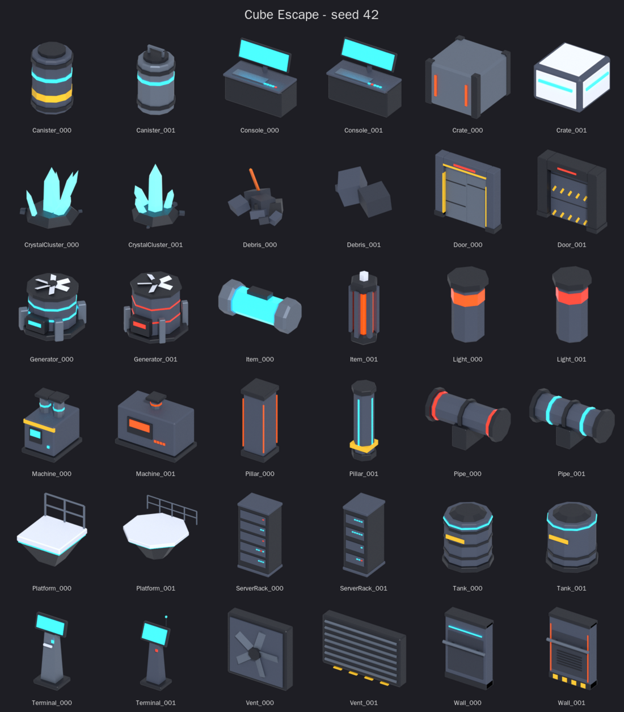
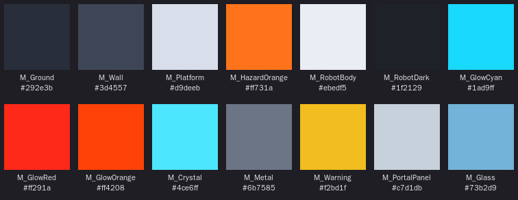
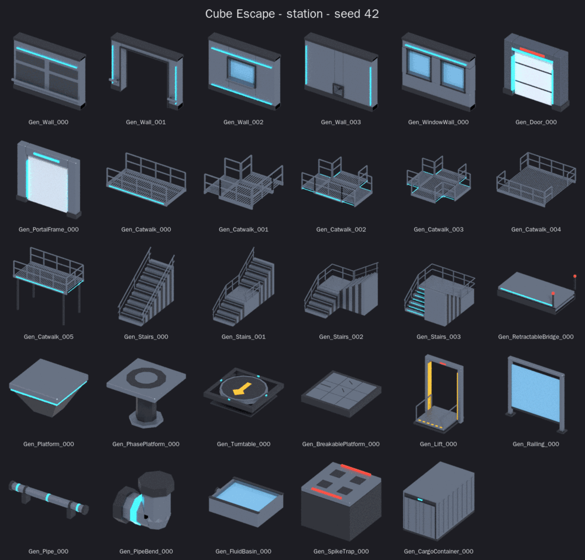
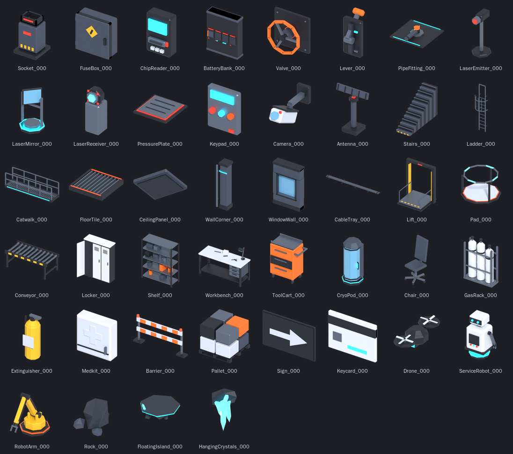
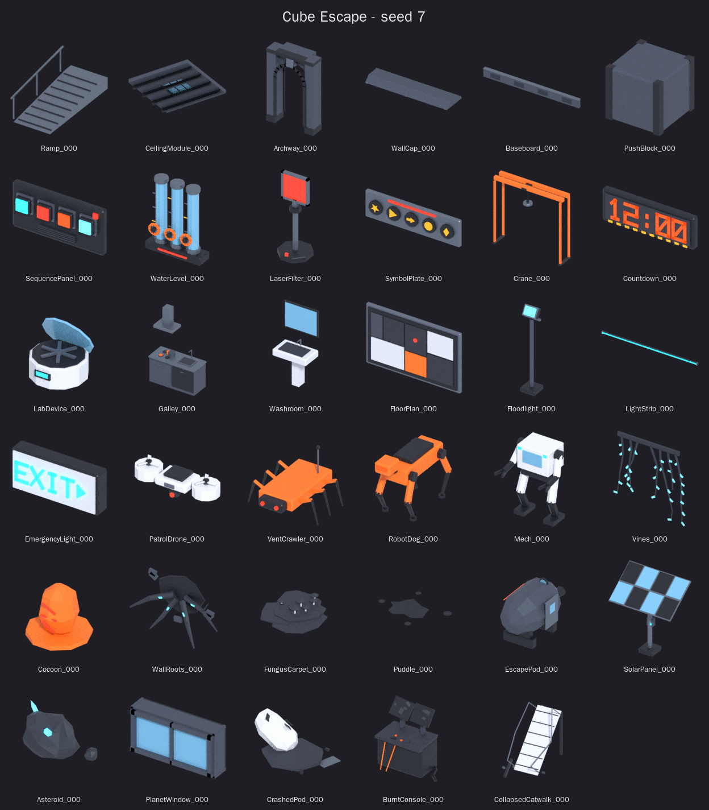
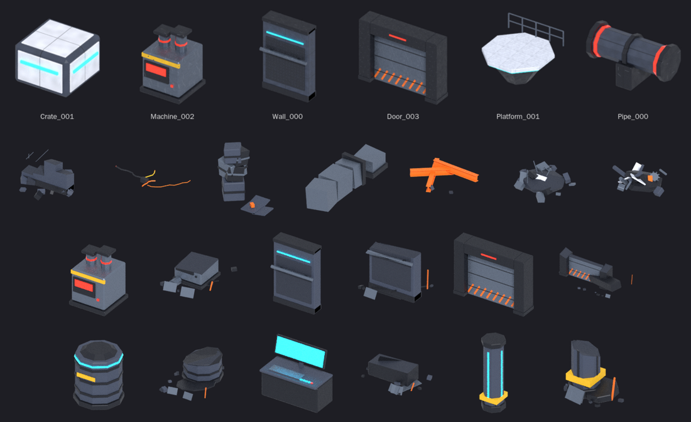
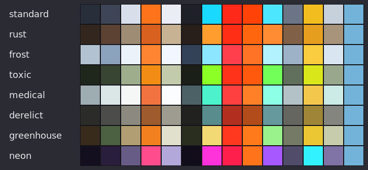

# Cube Escape – Model Generator Seed (`cubegen`)

Aktuelle Version: **0.12.0** (10. Oktober 2026). Release-Zweig: `release/0.12.0`.
Paket, CLI und Blender-Quell-Add-on verwenden dieselbe Version. 0.12.0 veröffentlicht die bisher
unveröffentlichten Arbeitsstände 0.11.1–0.11.4: erste Asset-Welle (elf Typen, drei Varianten, genaue
Kollision der Prototypen, [0.11.2](VERSION_0.11.2.md)), zweite Stationswelle und Kollision des eingestürzten
Stegs ([0.11.3](VERSION_0.11.3.md)), dritte Stationswelle, sieben Modell-Kits und Modellkorrekturen
([0.11.4](VERSION_0.11.4.md)) – [Versionsbericht 0.12.0](VERSION_0.12.0.md). Vorheriger veröffentlichter
Stand: [0.11.0](VERSION_0.11.0.md).
Die bisher geplanten 0.10.6-Arbeiten sind darin übernommen; historische Nachweise
stehen im [archivierten Arbeitsbericht](docs/archive/VERSION_0.10.6_WORKING.md).
Das Blender-Add-on-ZIP wird mit `python3 tools/build_addon.py` für 0.12.0 gebaut; ein lokal installiertes Add-on
muss danach neu installiert werden;
bereits geöffnete Blender-Sitzungen laden den Code nach Neustart/Neuladen.
Cube Escape enthält den geprüften Stand seit `464717e`, einschließlich der
sichtbaren Bruch-Testanlage Z-1. Bedienung und Prüfbelege stehen im Versionsbericht.
Vorherige Version: [0.10.5](VERSION_0.10.5.md).

Seed-basierter Low-Poly-Asset-Generator für **Cube Escape**. Ein *Master-Seed* erzeugt reproduzierbar ganze Batches
von Varianten im Stil der Station – Kisten, Kanister, Tanks, Rohre, Maschinen, Generatoren, Konsolen, Terminals,
Server-Racks, Lampen, Kristalle, Trümmer, Türen, Plattformen, Wände, Säulen, Lüftungen und Inventar-Items, dazu
Rätsel-Elemente (Sockel, Sicherungskasten, Ventil, Hebel, Rohr-Puzzle, Laser, Druckplatte, Keypad, Knöpfe,
Zahnradwerk, Kraftfeld, Steckfeld, Scanner, Tresor), Werkzeug-, Hinweis- und Ersatzteil-Items, ein modulares
Bau-Kit (Treppe, Leiter, Steg, Bodenplatte, Fensterwand, Lift, Förderband, Luke, Rolltor, Lüftungsschacht …),
Maschinen, Einrichtung, Roboter und Natur, dazu Fallen (Presse, Sägeblatt, Dampf, Strom), Geräte und
Gameplay-Bausteine (Portal, Phasen- und Bruchplattform, ausfahrbare Brücke, Drehscheibe, Stachelfalle, Becken,
Frachtcontainer), Bau-Kit-Ergänzungen (Rampe, Decken- und Dachmodul, Torbogen, Wandabschluss, Sockelleiste), weitere
Rätsel (Schiebeblock, Ton- und Farbfolge, Wasserstand, Laserfilter, Symbolplatten, Kran, Countdown), Labor, Messe,
Waschraum, Lageplan, Licht, Roboter, Alien-Bewuchs, Weltraum, Wracks und die erste Stationswelle (0.11.2) – 186 registrierte Typen einschließlich
Geometrie-Demo und experimenteller Test-Assets in 8 Kategorien.
**Modellfamilien** (`--family`) erzeugen Bau-Kits, deren Teile über verbindliche Maße zusammenpassen: Wand und Tür,
Treppe und Laufsteg, Rohr und Rohrbogen; im Add-on rasten die Teile an ihren Anschlusspunkten ein.

* **Blender CLI** baut die Meshes, exportiert **FBX für Unity** (optional GLB/glTF/OBJ), rendert Previews und
  speichert eine Übersichts-`.blend`.
* **ImageMagick** macht daraus **Inventar-Icons** (`Icon_<Name>.png`), einen **Kontaktbogen** zum Durchsehen und eine
  Material-Übersicht.
* **Clutter-/Accessoire-Pass** (`--clutter clean|lived-in|chaotic`) verteilt kleine Props deterministisch auf
  unterstützten Tischflächen. Im Export sind die Accessoires eigene `Clutter_*`-Mesh-Objekte; `tool`,
  `spare_part` und `keycard` bleiben zusätzlich als Einzelmodelle verfügbar.
* **Desktop-GUI**: `cubegen gui` (oder `cubegen-gui`) bietet Modell-/Rezeptauswahl, Qualitäts-Vorabprüfung,
  Batch-Export sowie gerenderte und interaktive 3D-Modellvorschauen.
* **macOS-App** (`app/`, seit 0.16.0): dasselbe als eigenständige `Cubegen.app` nach dem Vorbild des Robot Viewers –
  siehe [App (macOS)](#app-macos).

Zum visuellen Ausprobieren gibt es außerdem `geometry_test` und zehn experimentelle `test_...` Gameplay-Prototypen
(Technikrinne, Rohrgestell, Relaiskasten, Kühlkreislauf, Warnleuchte, Linsen-Array, Magnetsperre, Scanner-Matte,
Energie-Verteilpanel und Thermoschalter). Sie sind nicht Unity-geprüft und enthalten keine implementierte Puzzle-Logik.
Zum Beispiel alle zehn rendern: `python -m cubegen generate --seed 42 --types test_utility_trench,test_pipe_rack,test_relay_box,test_coolant_loop,test_warning_beacon,test_lens_array,test_magnetic_lock,test_scanner_pad,test_power_routing,test_thermal_switch --count 1 --out /tmp/cubegen_gameplay_tests`.

Bekannte Bugs, geplante Verbesserungen, Erweiterungen und offene Punkte im Unity-Projekt: [`docs/ROADMAP.md`](docs/ROADMAP.md).



## Kompatibel mit `generate_assets.py` des Spiels

Der Generator hält sich an dieselben Konventionen wie `Blender/Scripts/generate_assets.py`:

| Konvention | Umsetzung |
|---|---|
| 1 Blender-Einheit = 1 m, Z oben | ja |
| Front schaut nach **−Y** (Unity: +Z) | Bildschirme, Leitern, Ventile, Türfronten … zeigen nach −Y; 8-/10-/12-eckige Zylinder drehen eine flache Seite nach vorn (`align_flat`) |
| Pivot unten mittig | `floor`-Typen; Plattformen: begehbare Oberkante bei z = 0 (`top`); Items: Pivot in der Mitte (`center`); Wandmontiertes: Pivot am Boden darunter (`wall`) |
| Objekte haben nur eine Location | Rotation 0 / Skalierung 1, alles ist ins Mesh gebacken |
| Materialnamen = Unity-Materialien | exakt die `M_…`-Tabelle (`M_Wall`, `M_RobotDark`, `M_GlowCyan`, …) → Unity remappt automatisch |
| FBX-Exporteinstellungen | identisch zu `export_fbx()` (`bake_space_transform`, `axis_forward=-Z`, `axis_up=Y`, `FBX_SCALE_ALL`, …) |
| Teilenamen für Unity-Skripte | `Body`, `Glow` (wird umgefärbt, genau ein Material), `Rotor` (dreht), `Wheel` (Ventilrad), `Damage` (Maschine defekt), `Screen`, `Deck`, `Lights` (Deko-LEDs); Türen: `Frame_Left/Right/Top`, `StatusLight_Front/Back`, `Panel` (+ `Panel_B`) – mit Pivot im Dreh-/Bewegungspunkt |
| Icons | `Icon_<Name>.png`, 256 × 256, transparenter Hintergrund |



## Voraussetzungen

* Python ≥ 3.9 (keine weiteren Pakete)
* [Blender](https://www.blender.org) ≥ 3.6 (getestet mit 4.0 und 5.2 LTS) – wird über `PATH`, `$BLENDER`, `--blender` oder
  `/Applications/Blender.app/...` gefunden
* [ImageMagick](https://imagemagick.org) 6 (`convert`/`montage`) oder 7 (`magick`)

```bash
# prüft Blender, ImageMagick und die Render-Engines
python -m cubegen doctor
```

## App (macOS)

`Cubegen.app` (SwiftUI + SceneKit, ohne Xcode-Projekt gebaut wie der Robot Viewer des Roboter-Generators) erzeugt
Modelle wie das Desktop-Fenster: Typen nach Kategorie mit Filter, Familie oder Rezept, Seed, Varianten,
Ausgabeordner, Texturen (Art, Größe, Palette, Backgerät), Stil (alle Auswahloptionen aus `cubegen catalog`),
ähnliche Varianten überspringen, strikte Prüfung, alles neu bauen, nur OBJ, Blender-Prozesse. „Vorab prüfen“ zeigt
das Qualitätsranking, „Assets erzeugen“ (⌘R) den Fortschritt und das Protokoll, danach die Modelle als Galerie und
eins davon in 3D (Ansichten Iso/Vorne/Seite/Oben, Drehteller, Boden, Screenshot). Die Einstellungen bleiben zwischen
zwei Starts erhalten; der letzte Lauf erscheint beim Öffnen wieder.

```bash
app/build.sh            # -> output/app/Cubegen.app (universal, macOS 13+)
app/test_app.sh         # 17 Prüfungen ohne Fenster: Version, Katalog, Kommandozeile, 3D, Fenster, echte Läufe
open output/app/Cubegen.app
```

Die App trägt das cubegen-Paket in sich (`Contents/Resources/python`) und startet es mit Python 3.9+ (Homebrew,
python.org oder die Xcode-Kommandozeilenwerkzeuge); Blender und ImageMagick findet sie wie die Kommandozeile
(`python3 -m cubegen doctor`). Alle Symbole und das App-Icon zeichnet ImageMagick beim Bauen (`app/make_icons.sh`).
Die Kommandozeile der App ist dieselbe wie die des Desktop-Fensters (`app/test_app.sh` vergleicht die Textur-Argumente
mit `cubegen.gui.texture_args`); für die 3D-Ansicht exportiert sie zusätzlich OBJ.

## Blender-Add-on (GUI)

Das Add-on ist eine Oberfläche für denselben Generator, im 3D-Viewport unter **Seitenleiste (N) › Cube Escape**:

* **Typ, Master-Seed, Variante**: Pfeile ◀ ▶ blättern, 🔄 würfelt. Die Vorschau entsteht live am Ursprung, mit
  Dreiecken, Maßen und Teilenamen im Panel.
* **Familie & Kit**: Familie wählen (Maße und Look für Vorschau, Raster und Export), **Kit bauen** stellt das
  ganze Kit ins Raster, **Kit exportieren** exportiert es mit gemeinsamem Kontaktbogen und Passungsprüfung.
* **Einrasten**: Teil anklicken (aktiv), optional Ziel-Teile dazu wählen, **Einrasten** setzt es an den nächsten
  passenden freien Anschluss: Stegende an Stegende, Rampe an Plattform, Tür in die Wandöffnung, Wandabschluss auf
  die Wand, Sockelleiste an die Wandfläche, Rohr an Rohr, Deckenmodul an Deckenmodul. Belegte Anschlüsse werden
  übersprungen, wiederholtes Einrasten baut Ketten. **Anschlüsse zeigen** setzt Pfeile an alle Anschlusspunkte,
  **Reichweite** begrenzt die Suche. Das Teil dreht dabei nur um die Hochachse; exportiert wird wie immer vom Seed.
* **Von jedem Typ**: baut alle 164 Typen auf einmal ins Raster, auf Wunsch mehrere Varianten pro Typ (eine Reihe
  pro Typ). **Alle Typen exportieren** exportiert sie direkt, ohne vorher etwas auszuwählen.
* **Parameter**: Eigenschaften des gewählten Typs festlegen (Häkchen bzw. Auswahl statt „Seed“). Rechts steht, was
  der Seed gewählt hätte. Beim Anhaken startet der Wert dort. **Zurücksetzen** lässt wieder alles würfeln.
* **Stil (alle Typen)**: Raum-Thema, Größe, Raster, Glow-Farbe, Material, Warnfarbe, Abnutzung, Detail,
  Accessoire-Dichte und Icon-Kamera. Bei Accessoires übernimmt „Seed / Familie“ die Rezeptvorgabe, „Aus“ schaltet sie explizit ab. Das **Thema** (beliebiger Text) würfelt Glow-Farbe, Material, Abnutzung und Warnfarbe einmal für
  alle Modelle, damit ein Raum zusammenpasst.
* **Varianten-Raster**: z. B. 12 Varianten nebeneinander, beschriftet. Gute Varianten im Viewport anklicken
  (Shift = mehrere) und **Auswahl exportieren**. **Als Vorschau** übernimmt die Variante des aktiven Objekts.
  **Nur unterschiedliche** überspringt Varianten, die wie eine frühere aussehen.
* **Export für Unity**: Modell-, Icon- und Ausgabeordner, Präfix, FBX/GLB/OBJ, Icons + Kontaktbogen, LODs für
  statische Modelle, **Parallel** (mehrere Blender-Prozesse) und **Alles neu bauen** (sonst werden unveränderte
  Modelle übernommen). Der Export läuft im Hintergrund (Blender bleibt bedienbar) und nutzt exakt die Pipeline der
  Kommandozeile. Ein Export aus dem
  Add-on ergibt also dieselben Dateien wie `python -m cubegen generate --seed 42 --pick crate:3 --prefix Gen_`.
  Der Knopf **CLI** kopiert genau diesen Befehl.

**Installieren**

```bash
# baut dist/cubegen_blender_addon.zip
python3 tools/build_addon.py
```

In Blender: *Edit › Preferences › Add-ons › Install…* (ab 4.2: Pfeil-Menü oben rechts › *Install from Disk…*), die
Zip wählen und „Cube Escape Model Generator“ aktivieren. Findet das Add-on ImageMagick nicht (Blender aus dem Finder
gestartet), trägst du den Pfad in den Add-on-Einstellungen ein, z. B. `/opt/homebrew/bin/magick`. Standardmäßig wird
`/opt/homebrew/bin` aber schon durchsucht.

*Für die Entwicklung* kannst du statt der Zip den Ordner verlinken; das Add-on nutzt dann direkt den Code im Repository:

```bash
ln -s "$PWD/blender_addon/cubegen_addon" \
      ~/Library/Application\ Support/Blender/<Version>/scripts/addons/cubegen_addon
```

Das Add-on legt nur die Collections „CubeEscape Vorschau“ und „CubeEscape Varianten“ an und erzeugt fehlende
`M_…`-Materialien. Bestehende Materialien (z. B. in `CubeEscape_Assets.blend`) bleiben unverändert. **Aufräumen**
entfernt beides wieder.

## Herunterladen (macOS / Linux)

```bash
curl -fsSL https://raw.githubusercontent.com/ffunkfabian-hash/lowpoly_cubeescape_model_generatior/HEAD/tools/install.sh | bash
```

Das Script ([`tools/install.sh`](tools/install.sh)) lädt das Projekt nach `~/cubegen` (mit git, sonst als Archiv),
legt den Befehl `cubegen` in `~/.local/bin` an, baut das Blender-Add-on (`~/cubegen/dist/cubegen_blender_addon.zip`)
und prüft Blender und ImageMagick. Erneut ausführen aktualisiert auf den GitHub-Standardbranch; `--branch BRANCH`
wählt stattdessen explizit einen anderen Branch. Weitere Optionen: `--dir ORDNER`, `--no-link`
(als `… | bash -s -- --dir ~/tools/cubegen`).

## Schnellstart (Kommandozeile)

Ausführliche Anleitung mit allen Optionen: [`docs/CLI.md`](docs/CLI.md).

Die Desktop-Oberfläche startest du nach Installation mit:

```bash
cubegen gui
```

Die GUI bietet zusätzlich zur vorhandenen Blender-Add-on-Oberfläche einen eigenständigen Build-Workflow. Wähle
Modelltypen oder ein JSON-Rezept, Seed und Ausgabeordner; die Vorabprüfung bewertet und sortiert Varianten, und der
Export übernimmt unveränderte Assets aus dem letzten Lauf. **Modellvorschau öffnen** zeigt die Vorschau in einem
eigenen, größenverstellbaren Fenster. Nach dem Export öffnet es sich automatisch und zeigt gerenderte Bilder sowie
eine interaktive 3D-Ansicht (ziehen zum Drehen, Mausrad zum Zoomen). Für gerenderte Bilder wird Blender benötigt;
die 3D-Ansicht verwendet die zusätzlich exportierte OBJ-Datei. **Alles neu bauen** erzwingt einen vollständigen Neuaufbau.
**Texturen** (seit 0.13) wählt dieselben Arten wie `--textures` (keine, Kacheln, Kacheln + Gebrauchsspuren, Farbpalette),
dazu Texturgröße und – nur im Paletten-Modus – die Farbpalette; siehe [Texturen](#texturen-optional).

Die `#`-Zeilen in den Beispielen sind Kommentare. Die zsh auf dem Mac kennt sie im Terminal nur nach
`setopt interactivecomments`; sonst einfach nur die Befehlszeilen kopieren.

```bash
# alle 164 Typen je 2x, Seed 42 -> output/seed_42/
python -m cubegen generate --seed 42 --count 2

# Assets mit Script (Tür, Maschine, Ventil …) direkt dorthin, wo AddModel sie lädt
python -m cubegen generate --seed 7 --types machine,door --count 3 --prefix Gen_ \
    --models-dir ../CubeEscape/Assets/Art/Models

# von jedem Typ eins – Modelle mit Script nach Art/Models, Deko automatisch nach Library/<Kategorie>
python -m cubegen generate --seed 7 --prefix Gen_ \
    --models-dir  ../CubeEscape/Assets/Art/Models \
    --library-dir ../CubeEscape/Assets/Art/Models/Library

# Batch aus einem Rezept
python -m cubegen generate --recipe recipes/station_props.json

# einzelne Varianten gezielt (gleiche Namen/Seeds wie mit --count)
python -m cubegen generate --seed 42 --pick crate:3,door:7 --prefix Gen_

# erst ansehen, was entstehen würde (ohne Blender)
python -m cubegen generate --seed 42 --types door,pipe --count 3 --dry-run

# ein Raum aus einem Guss, nur Varianten, die sich wirklich unterscheiden
python -m cubegen generate --seed 7 --theme labor-3 --types crate,machine,wall --count 6 --unique

# alle Typen, Deko mit Sparstufe (LOD), 4 Blender-Prozesse; erneut ausgeführt baut es nur Geändertes
python -m cubegen generate --seed 42 --count 3 --lods --jobs 4

# Qualitätsbericht: Dreiecke, Draw Calls, flackernde Flächen, Doppelte
python -m cubegen check

# ein Bau-Kit, dessen Teile zusammenpassen (Familien: station, foundry, lab, medbay, derelict, greenhouse, reactor)
python -m cubegen generate --family station --seed 42 --prefix Gen_
python -m cubegen check --family station

# alle Typen
python -m cubegen list
```

Ohne Blender (z. B. CI oder schnelles Iterieren) schreibt `--no-blender` OBJ + MTL in reinem Python – gleiche
Geometrie und Materialien, aber ohne Pivots, Previews und Icons.

## Ausgabe

```
output/seed_42/
├── models/                       Gen_Crate_000.fbx + Gen_Crate_000.cubegen.json (Teile, Pivots, Script-Werte)
├── icons/                        Icon_Gen_Crate_000.png   (ImageMagick: getrimmt, zentriert, Schatten)
├── previews/                     Rohe Blender-Renders
├── contact_sheet.png             alle Previews mit Namen
├── materials.png                 Material-Übersicht
├── CubeEscape_Generated_42.blend Übersichtsdatei: alle Assets im Raster, Teile heißen <Asset>.<Teil>
└── manifest.json                 Seeds, Dateien, Pivots, Teilenamen, Maße, Dreiecke, Varianten-Infos
```

## Wohin im Unity-Projekt?

| Asset | Ordner | Warum |
|---|---|---|
| bewegt sich / hat Zustände (Tür, Maschine, Generator, Ventil, Lampe, Terminal, Lüfter, Item, Rätsel-Elemente, Lift, Förderband, Roboter …) | `Assets/Art/Models` | `AddModel` lädt `Assets/Art/Models/<Name>.fbx`; der Prefab-Builder braucht eine Rezeptzeile in `ModularBlocks.cs` (Werte stehen in `<Name>.cubegen.json`) |
| reine Deko (`"static": true` in der JSON) | `Assets/Art/Models/Library/<Kategorie>` | `AssetRegistry` registriert sie automatisch als statische Hülle mit BoxCollider (begehbare Teile wie Treppe oder Steg bringen eigene [Collider](#collider) mit) |

Mit `--library-dir` (im Add-on: Feld „Bibliothek“) sortiert der Generator das selbst: Modelle ohne Script landen in
`<Bibliothek>/<Kategorie>` (Props, Industrial, Tech, Environment, Ruins, Nature …), alle anderen im Modell-Ordner.

Das Präfix (`--prefix Gen_`) verhindert Namenskollisionen mit den handgebauten Modellen. Unity-Importeinstellungen
gelten nur beim ersten Import einer Datei. Eine neu generierte FBX unter demselben Namen behält sie also.

## Modellfamilien & Bau-Kits



Eine Familie (`cubegen/family_data/<Name>.json`) ist ein Rezept mit verbindlichen Maßen (`dims`): Wandhöhe und
-stärke, Modullänge, Tür-/Fensteröffnung mit Rahmenmaß, Laufstegbreite, Geländer- und Ebenenhöhe,
Plattformgröße, Rohrradius und Achshöhe. Dazu kommen Material, Glow, Warnfarbe, Abnutzung, Detailgrad und
Texturset. Eine zentrale Tabelle (`cubegen/families.py`, `python -m cubegen families --dims`) bildet jedes Maß
auf die Parameter aller Typen ab, die ihm folgen. Ein Rezept mit `"family": "station"` baut darauf auf, seine
eigenen Werte gelten als Abweichung und stehen so im Manifest.

* **Gleiches Modell**: gleiche Variante, Parameter und Version = gleiche Dateien.
* **Variante in der Familie**: `--family station --types catwalk --count 8`, Details wechseln, Maße bleiben.
* **Passendes Teil**: `--family station --types door` (Tür zur Wand) oder `--match <Name>.cubegen.json --types
  pipe_bend` (Rohrbogen zu einem vorhandenen Rohr).
* **Passungsprüfung** (`check --family`, auch im Manifest unter `family.fit`): setzt die Teile aneinander und
  prüft Breiten, Höhen, Ausrichtung, begehbaren Boden über jeder Fuge, freien Durchgang, Tür bzw. Portal in
  der Wandöffnung und Rohre durch Durchführungen.
* Anschlusspunkte (`connectors`) und die Herkunft jedes Parameters (`param_sources`) stehen im Manifest. Der
  Sidecar bleibt im Vertrag des Unity-Imports und bekommt keine neuen Felder.

**Mitgelieferte Familien** (`python -m cubegen families`):

| Familie | Maße und Look | Requisiten im Kit |
|---|---|---|
| `station` | 3-m-Wände, Schiebetüren 2,0 × 2,2 m, 2-m-Stege auf 3 m, Metall/Cyan | – (Bau-Kit, Gameplay-Bausteine) |
| `foundry` | 4-m-Wände, schwere Türen, 1-m-Stege auf 2 m, dicke Rohre, dunkel/orange, Warnstreifen, Abnutzung | – |
| `lab` | 3-m-Wände (0,3 m) im 2-m-Raster, Sicherheitstüren, hell/rot, hoher Detailgrad, eigenes Texturset | – |
| `medbay` | Krankenstation: 0,3-m-Wände im 2-m-Raster, Schiebetüren 1,6 × 2,2 m, hell/cyan | Liegen, Kryo-Kapsel, Medkit, Labortisch, Mikroskop, Reagenzgläser, Zentrifuge, Waschbecken, WC, Dusche, Monitorwand, Schilder „MED-1“, Lageplan |
| `derelict` | verlassenes Wrack: Sicherheitstüren, dunkel/orange, **beschädigt**, starke Abnutzung | Trümmer, Wandruine, abgestürzte Kapsel, ausgebrannte Konsole, eingestürzter Steg, Kabelsalat, Androide, Wurzeln, Ranken, Ölpfütze, Rundumleuchte, Countdown |
| `greenhouse` | Gewächshaus: 3,5-m-Wände, große Fenster, Oberlichter und Dach, hell/orange | Pflanzbeete, Pflanzen, Pilze, Ranken, Pilzteppich, Kokon, Pfütze, Wasserstand-Rätsel, Becken, Rohre, Pflanzenlampen, Solarpanel, Fenster mit Planet |
| `reactor` | Reaktor: 4-m-Wände (0,6 m), Explosionsschutztüren, 2-m-Stege auf 3 m, 35-cm-Rohre, Metall/Rot, Warnstreifen | Reaktorkern, Trafo, Generator, Pumpe, Server, Konsole, Strom-Bodenplatte, Dampf, Kran, Countdown „KERNSCHMELZE“, Lageplan |

Alle Kits enthalten jetzt auch Torbogen, Wandabschluss, Sockelleiste, Decken-/Dachmodul und Rampe (neue Teile
ändern keine bestehenden). Neu in `dims`: `ceiling_thickness` (Deckenstärke). Neue Passungsregeln: Wandabschluss
auf der Wand (Stärke, Höhe, Wand = ganzes Vielfaches der Abschlusslänge), Sockelleiste an der Wandfläche, Rampe an
Steg/Plattform, Decke an Decke. Dieselbe Anschluss-Tabelle (`families.JOINS`) steuert das Einrasten im Add-on
(`cubegen/snapping.py`).

Neue Varianten bestehender Typen sind Parameter: `wall.opening` (`door`, `window`, `pipe`) mit Rahmen- bzw.
Öffnungsmaßen, `wall.height`/`thickness`, `catwalk.shape` (`corner`, `tee`, `cross`, `landing`, `end`),
`stairs.layout` (`landing`, `quarter`, `switchback`). Details in [`docs/CLI.md`](docs/CLI.md), was der
Unity-Import davon nutzt und was dort noch fehlt in [`docs/UNITY_INTEGRATION.md`](docs/UNITY_INTEGRATION.md).

## Reproduzierbarkeit & Qualität

* **Modell-Generationen**: Korrekturen, die bestehende Seeds sichtbar verändern, gelten erst ab einer neuen
  Generation (`--generation`, Rezept/Familie `"style": {"generation": 1}`, Add-on „Generation“). Generation 1 baut
  die Modelle von cubegen 0.9.0 bitgleich nach (nur die korrigierte Tür-Verdrahtung der Luftschleuse bleibt),
  Generation 2 ohne flackernde Flächen, Generation 3 (Standard) zusätzlich mit [Ankern für Ton und
  Effekte](#anker-für-ton-und-effekte); dort verlieren beschädigte Türrahmen keine Teile mehr in den Durchgang. `--match` baut ein vorhandenes Modell in seiner Generation nach (Sidecars ohne
  `style.generation` stammen aus Generation 1).
* **Gleicher Seed = gleiches Modell**, auch nach Updates und mit anderer Python-Version. `tests/golden.json`
  enthält Fingerabdrücke aller Typen; der Test schlägt fehl, sobald sich ein Modell ändert. Der Zufall läuft über
  einen eigenen, eingefrorenen Würfel (`StableRandom`), und Summen werden so gerechnet, dass Blenders Python 3.11
  und Python 3.9 bis 3.13 bitgenau dieselben Dateien bauen. CI testet mit 3.9, 3.11 und 3.13.
* **Neue Details ohne alte Seeds zu ändern**: Ein Builder würfelt Neues aus einem eigenen Strom,
  `a.sub("name")`, statt aus `rng`. Sonst würden alle späteren Würfe verrutschen.
* **`python -m cubegen check`** meldet pro Typ die Dreiecke gegen das Budget der Kategorie, Draw Calls,
  flackernde Flächen (Z-Fighting) und wie viele Varianten sich wirklich unterscheiden. Flackernde Flächen gibt es
  keine: Liegt ein Detail (Streifen, Glow-Leiste, Paneel) bündig auf einer anderen Fläche, hebt der Generator die
  kleinere Fläche um 2 mm an. Draw Calls: höchstens 16 pro Modell, bei Modellen aus vielen einzeln beweglichen
  Teilen (Platten, Beine, Rollen) 2 pro Teil + 2; statische Modelle zählen ein Material einmal (Static Batching).
  Die Tests prüfen beides für alle Typen und Zustände.
* Absichtlich ein Modell geändert? `python3 tests/golden_cases.py --update` schreibt beide Referenzdateien neu
  (und in den CHANGELOG gehört, welche Seeds anders aussehen).
* **Unity-Vertrag**: `cubegen/contract.py` prüft bei jedem Export jeden Sidecar mit den Regeln des Spiel-Imports
  (`Docs/CUBEGEN_IMPORT.md`), bevor Blender startet, und danach gegen die echte FBX. Ein Verstoß bricht den
  Export mit allen Fundstellen ab; offene Item-IDs stehen als Hinweis im Log. Einen fertigen Export-Ordner prüft
  `python -m cubegen check --export <Ordner>`. Die Regeln stehen maschinenlesbar in `cubegen/contract.json`
  (Schlüssel, Rollen, Feldtypen, Toleranzen, Dateigrenzen); `python -m cubegen contract --out <Datei>` gibt
  dieselbe Datei an den Unity-Import weiter, damit beide Seiten nach denselben Regeln prüfen.
* **Item-IDs**: `--param keycard.item_id=<ID>` schreibt `ItemPickup.fields.itemId`; cubegen erfindet keine IDs.

## Animation & Unity-Scripts

Im Spiel gibt es **keine Animation-Clips**: Animationsimport ist abgeschaltet, alles läuft prozedural über Scripts
(`Door`, `Machine`, `Rotator`, `Rotatable`, `SignalLight`, `SignalIndicator` …). Die Prefab-Builder setzen deren
Felder. Der Generator liefert deshalb keine Keyframes, sondern neben jeder FBX eine **`<Name>.cubegen.json`**:

* `parts`: Teile mit Parent, `localPosition` **in Unity-Koordinaten** und Materialien
* `behaviours`: welches vorhandene Script welche Teile steuert, mit den Feldwerten in Unity-Einheiten
* `bounds`, `category`, `pivot`, `seed`; `"static": true` heißt reine Deko
* `colliders` (nur wo nötig): fertige Kollisionsformen, siehe [Collider](#collider)
* `lods` (nur mit `--lods`, nur statische Modelle): Die FBX enthält jedes Teil als `<Teil>_LOD0` und `<Teil>_LOD1`
  (Unity baut daraus beim Import die LODGroup); `parts` und `colliders` nennen die Teile ohne Endung
* `style`: der Stil, mit dem das Modell gebaut wurde (ein Thema ist darin schon aufgelöst)

Die FBX und ihre `<Name>.cubegen.json` stimmen immer überein: Nach jedem Export liest der Generator die FBX zurück
und vergleicht Eltern, lokale Pivots, Rotation (immer 0) und Vertices. Bei einer Abweichung bricht er ab. (Bis
0.7.0 hatten Teile ab der dritten Ebene, `balance_scale` `Slot_A`/`Slot_B`, `robot_arm` `Arm_Upper`/`Gripper`
und `turret` `Glow`, wegen eines Fehlers in Blenders FBX-Export falsche Pivots und 90° Drehung.)

```json
{ "script": "Door",
  "parts":  { "panels": ["Panel", "Panel_B"], "statusLights": ["StatusLight_Front", "StatusLight_Back"],
              "upperFrame": ["Frame_Top"], "colliders": ["Frame_Left", "Frame_Right", "Frame_Top"] },
  "fields": { "openOffset": [1.25, 0.0, 0.0], "speed": 1.8 } }
```

| Typ | Script(s) | Werte (wie in `ModularBlocks.cs`) |
|---|---|---|
| `door` | `Door` | Weg nach Stil und **generierter Größe**: Sliding/Elevator seitlich Blattbreite + 0,05; Heavy/Security −(Höhe + 0,1); Blast +(Höhe + 0,1); Airlock geteilt Blatthöhe + 0,05. Tempo: 3 / 0,9 / 4 / 1,8 / 1,2 / 0,6 m/s |
| `machine` | `Machine` (+ `Rotator` am `Rotor`) | `Glow` startet `M_GlowRed`; `Damage` (nur bei Defekt sichtbar); Rotor-Achse `right`, Tempo nach Größe |
| `generator` | `Machine` + `Rotator` | Rotor-Achse `up`, größere Lüfter drehen langsamer (wie Generator 140 / Generator_Small 260) |
| `pipe` | `Rotatable` (mit Ventil) bzw. `SignalIndicator` | Ventilrad: Achse `forward`, Schritt 90°, 180 °/s, Ziel 2; Glow-Ringe: `M_RobotDark` ↔ `M_GlowCyan` |
| `vent` (mit Lüfter) | `Rotator` | Achse `forward`, 160 °/s (wie Vent_Large) |
| `light` | `SignalLight` | Mast `Steady`, Poller `Pulse`, Rundumleuchte `Rotate` (`Rotor` um Unity-Y) |
| `terminal` | `SignalIndicator` | `M_GlowRed` ↔ `M_GlowCyan` |
| `item` | `ItemPickup` | Pivot in der Mitte, dreht um Welt-Y |
| `keycard` | `ItemPickup` | wie `item` (Karte, Anhänger, Schlüssel) |
| `socket`, `chip_reader`, `battery_bank`, `keypad`, `laser_receiver`, `pressure_plate` | `SignalIndicator` | `Glow` `M_GlowRed` ↔ `M_GlowCyan`; leere Objekte `Slot` / `Slot_<n>` markieren, wo ein eingesetztes Item sitzt |
| `fuse_box` | `Rotatable` + `SignalIndicator` | Deckel `Panel` schwenkt um sein Scharnier (Achse `up`, Schritt `lid_angle`, Ziel 1); `Slot_<n>` = Sicherungen |
| `valve` | `Rotatable` | Rad `Wheel`: Achse `forward`, Schritt 90°, Ziel `steps` (wie das Ventil am Rohr) |
| `lever` | `Rotatable` | Hebel: Achse `right`, 90° auf `positions` Stellungen verteilt; Drehschalter: Achse `forward`, 360° / `positions` |
| `pipe_fitting` | `Rotatable` | `Fitting` dreht um `up` in 90°-Schritten, Ziel `target`; die Anschlüsse in Ruhe stehen in `note` |
| `laser_mirror` | `Rotatable` | `Mirror` ruht auf 45°, dreht um `up` in 45°/90°-Schritten |
| `laser_emitter` | `SignalLight` | leeres Objekt `Beam` = Startpunkt des Strahls (Richtung Unity-forward) |
| `camera`, `antenna` | `Rotator` + `SignalLight` | Kopf `Rotor` dreht um `up` (Kamera standardmäßig `speed` 0 = steht, weil `Rotator` endlos dreht); LED blinkt bzw. pulsiert. **Schwenken** mit `camera.sweep=120`: der Kopf ist um den halben Winkel vorgedreht gebaut, `Rotator.arc` = 120 schwenkt ihn ±60° (ohne `speed` 30 °/s); die LED ist dann Kind des Kopfes |
| `turret` | `Rotator` + `SignalLight` | `Turret` giert um `up`, `Gun` neigt sich um `right`; `turret.sweep=120` schwenkt symmetrisch wie die Kamera |
| `ceiling_panel` | `SignalLight` (Licht) bzw. `Rotator` (Lüfter) | Lüfter um `up`; `plain` ist statisch |
| `lift` | `Door` | `Deck` fährt beim „Öffnen“ um `travel` nach oben (`openOffset` = (0, Hub, 0)) |
| `conveyor` | je Rolle ein `Rotator` | `Roller_<n>` drehen um `forward` |
| `pad` | `SignalLight` (+ `Rotator` beim Teleporter) | Teleporter-Ring `Rotor` um `up` |
| `drone` | je Propeller ein `Rotator` + `SignalLight` | `Rotor_<n>` um `up`, benachbarte gegenläufig; Pivot in der Mitte |
| `service_robot` | `SignalLight` (+ `Rotator` für `Head`, wenn `head_speed` > 0) | Augen `Glow` sind Kinder von `Head` |
| `robot_arm` | `SignalIndicator` (+ `Rotator` für `Turret`, wenn `turret_speed` > 0) | Gelenkkette `Turret` → `Arm_Lower` → `Arm_Upper` → `Gripper`, Pivots in den Gelenken |
| `sequence_panel` | `SignalLight`; Tasten-Anzeiger für später vorbereitet | `Light_<n>` (Kind von `Button_<n>`); unabhängige Anzeiger in `meta.deferred_behaviours`, Farben und Folge im Manifest; eigener Unity-Adapter nötig |
| `water_level`, `symbol_plate`, `laser_filter`, `crane` (Drehkran), `escape_pod` | `Rotatable` | Ventilräder `Wheel_<n>` (forward, 90°), Platten `Plate_<n>` (forward, 90°), Filter `Filter` (up, 90°), Ausleger `Jib` (up, 45°), Luke `Panel` (up, ±100°) |
| `floodlight` | `SignalLight` mit `lightPosition`, `range`, `intensity` | Unity setzt dort ein echtes Licht |
| `light_strip`, `emergency_light`, `countdown`, `floor_plan`, `solar_panel`, `cocoon` | `SignalLight` | Notleuchte als Rundumleuchte: `Rotate` mit `Rotor` |
| `patrol_drone`, `vent_crawler`, `robot_dog`, `mech` | `SignalLight` (+ `Rotator` für Propeller / Scanner / Torso) | Gelenke mit Pivot: `Leg_<n>` an der Hüfte, `Head` am Hals, `Torso` an der Hüfte, `Arm_L/R` an der Schulter |

Achsen: Unity = (−Blender-X, Blender-Z, −Blender-Y). Also ist Blender X → `right`, Blender Z → `up` und Blender −Y →
`forward`. Teile, deren Material das Spiel tauscht (`Glow`, `StatusLight_*`, `Screen`), haben genau **ein**
Material, weil `renderer.sharedMaterial` nur Slot 0 ersetzt. Mehrfarbige Deko-LEDs heißen `Lights`.

Für den Unity-Import liegt in [`docs/UNITY_INTEGRATION.md`](docs/UNITY_INTEGRATION.md) ein Prompt, mit dem eine KI
im Spielprojekt einen Editor-Import für diese JSON-Dateien an die vorhandenen Builder anschließen kann. Ein
zweiter Prompt dort ergänzt die Mechanik, für die das Spiel noch kein Script hat: Item-Sockel, Laser mit Spiegeln,
Druckplatte, Rohr-Puzzle, Kamera-Schwenk, Leiter, Sprung-/Teleporter-Pad, Förderband, Lift-Knöpfe und
Leerlauf-Animationen für Drohne und Roboterarm.

## Collider

Die FBX enthält keine Collider. Für die meisten Modelle reicht die Hülle, die `AssetRegistry` bzw. der Import
anlegt. Bei begehbaren und bewegten Teilen ist sie falsch (Treppe als Block, Steg mit Geländer-Hülle, Luke ohne
Öffnung). Diese Typen schreiben deshalb eigene Formen in die `<Name>.cubegen.json`:

```json
"colliders": [
  { "type": "box", "part": null,    "center": [0, 0.6, 0.1], "size": [1.2, 0.3, 0.21], "rotation": [0, 0, 0, 1] },
  { "type": "box", "part": "Panel", "center": [0, -0.03, -0.5], "size": [1.0, 0.06, 1.0], "rotation": [0, 0, 0, 1] },
  { "type": "mesh", "part": "Deck", "convex": true }
]
```

* `part`: Teil, an dem der Collider hängt und mit dem er sich bewegt (Deckel, Lift-Deck, Kraftfeld …), `null` = Wurzel.
* `center` / `size` in Unity-Koordinaten relativ zum Pivot des Teils; `rotation` = Unity-Quaternion (x, y, z, w).
  Ein `BoxCollider` kann sich nicht drehen: gedrehte Boxen (Rampe, Wendeltreppe) bekommen ein eigenes Kind-Objekt.
* `mesh`: `MeshCollider` auf dem Mesh des Teils (`convex` = Unity bildet die konvexe Hülle).
* Fehlt `colliders`, bleibt alles wie bisher (Hülle). Zerstörte Varianten (`--damage destroyed`) haben keine.

| Typ | Collider |
|---|---|
| `stairs` | eine Box je Stufe; Rampe: schräge Box auf der Fläche + gestapelte Boxen darunter; Geländer als Zaun |
| `spiral_stairs` | eine gedrehte Platte je Stufe, Podest, Mast, Zaun außen |
| `catwalk` | nur die Deck-Platte, Geländer und Stützen einzeln (unter dem Steg bleibt frei) |
| `platform`, `floating_island` | `mesh` (konvex) auf `Deck` bzw. `Island` |
| `floor_tile` | Deck-Platte |
| `hatch`, `floor_grate` | Rahmen und Schachtwände einzeln (der Schacht bleibt offen), Deckel / Rost auf `Panel` |
| `vent_shaft` | Boden, Decke und geschlossene Seiten (innen begehbar), Gitter auf `Grille` |
| `lift` | Sockel, Säulen, Träger, Deck mit Geländer auf `Deck` (fährt mit) |
| `force_field`, `crusher`, `cage` | Rahmen; `Field` / Pressenkopf `Panel` / Käfigtür `Panel` mit eigenem Collider |
| `railing`, `shock_plate`, `saw_blade` | flache Box statt Hülle (Geländer, Bodenplatte + Spulen, Gehäuse + Blatt) |

## Parameter & Stil

Standardmäßig würfelt der Seed alles. Einzelne Eigenschaften lassen sich **festlegen**, ohne dass sich der Rest
der Variante ändert: Ein Parameter würfelt intern immer weiter wie bisher, nur das Ergebnis wird ersetzt. Ohne
Parameter liefern alle Seeds exakt dieselben Modelle wie vorher.

```bash
# alle Parameter (python -m cubegen params door: nur Türen)
python -m cubegen params

# Airlock-Tür mit 2 m Öffnung und langsamerem Öffnen, sonst wie Variante 3 von Seed 42
python -m cubegen generate --seed 42 --pick door:3 --param door.style=airlock \
    --param door.width=2.0 --param door.speed=0.8

# ganzer Batch im gleichen Look
python -m cubegen generate --seed 7 --size L --snap 0.5 --glow cyan --material-style metal \
    --warning none --wear light --detail low
```

**Stil (für alle Typen)**

| Option | Werte | Wirkung |
|---|---|---|
| `--theme` | beliebiger Text | Raum-Thema: würfelt Glow-Farbe, Material, Abnutzung und Warnfarbe einmal für alle Modelle; einzeln festgelegte Werte gehen vor |
| `--size` | S / M / L | Größen aus dem unteren / mittleren / oberen Drittel der Bereiche |
| `--snap` | z. B. 0.5 | Hauptmaße auf Vielfache runden (Radien: der Durchmesser), passend zum Modulraster |
| `--glow` | cyan / red / orange | feste Farbe für Deko-Glow. Status-Teile (Maschine, Generator, Terminal, Tür) behalten ihre Zustandsfarbe |
| `--material-style` | metal / wall / dark / light | bevorzugtes Körpermaterial, wo es eine Option ist |
| `--warning` | none / always | Warnstreifen und -bänder nie oder immer |
| `--wear` | none / light / heavy | Brocken, lose Platten, abgerissenes Kabel als eigenes Teil `Wear` (verändert das Modell selbst nicht) |
| `--detail` | low / normal / high | low: keine Fasen, weniger Zylinder-Seiten; high: rundere Zylinder |
| `--damage` | intact / damaged / destroyed / fractured | Zustand, siehe „Zerstörung & Ruinen“ |
| `--generation` | 1 / 2 / 3 (Standard 3) | Modell-Generation: 1 baut mit cubegen 0.9.0 exportierte Modelle bitgleich nach, 2 ohne flackernde Flächen und mit 2 Materialien pro beweglichem Teil, 3 zusätzlich mit Ankern `Audio_*`/`FX_*` (Rezept: `"style": {"generation": 2}`) |
| `--icon-angle`, `--icon-zoom` | z. B. `=-25,15`, 1.3 | Kamera für Previews und Icons (Azimut, Elevation wie die `ICONS`-Tabelle des Spiels) |

**Parameter pro Typ** (`--param TYP.NAME=WERT`, mehrfach möglich; alle Typen, erzeugt mit
`python3 tools/param_table.py --write`)

<!-- params:begin -->
| Typ | Parameter (Wertebereich; 🔗 = Wert für ein Unity-Script) |
|---|---|
| `airlock_chamber` | `length` (2–6), `width` (1.4–3), `height` (2.2–3.4), `window` (ja/nein), `stripes` (ja/nein), `state` (closed / outer_open / inner_open / open, Standard closed) |
| `android` | `pose` (standing / slumped), `height` (1.2–2.4), `visor` (visor / eyes) |
| `antenna` | `style` (mast / radar / dish), `height` (0.8–6), `speed` (0–360) 🔗 |
| `archway` | `length` (1.5–8), `height` (2–6, Standard 3), `thickness` (0.2–1, Standard 0.5), `width` (0.8–4), `opening_height` (1.8–5.5), `shape` (round / pointed / chamfer / flat), `glow` (ja/nein) |
| `asteroid` | `size` (0.4–5), `crystals` (0–6), `moonlets` (0–4) |
| `balance_scale` | `width` (0.6–2.4), `height` (0.8–2), `tilt` (3–30, Standard 12) 🔗, `status` (off / on, Standard off) |
| `barrier` | `style` (gate / jersey / cones), `width` (0.8–4), `lights` (ja/nein) |
| `baseboard` | `length` (1–8), `height` (0.08–0.4), `style` (plain / vent / glow / duct) |
| `battery_bank` | `bays` (1–8), `height` (0.6–3), `filled` (0–8), `status` (off / on, Standard off) |
| `bed` | `style` (cot / bunk / medical), `length` (1.6–2.4), `blanket` (ja/nein), `lamp` (ja/nein) |
| `bin` | `style` (round / square / recycling / hazard), `height` (0.3–1.4), `open` (ja/nein), `trash` (ja/nein) |
| `breakable_platform` | `size` (1.0 / 2.0 / 3.0 / 4.0), `tiles` (2 / 3), `cracks` (1–10), `weak_spots` (ja/nein), `supports` (ja/nein) |
| `broken_wall` | `length` (2.0 / 4.0), `remaining` (0.1–1), `hole` (ja/nein), `rebar` (ja/nein) |
| `bulkhead` | `style` (frame / chamfer / ring), `width` (1.2–6), `height` (2–4.5), `pipes` (ja/nein), `stripes` (ja/nein) |
| `burnt_console` | `width` (0.6–3), `screens` (1–3) |
| `button` | `style` (push / emergency / row), `count` (2–6), `mount_height` (0.5–2.5), `guard` (ja/nein), `stripes` (ja/nein), `status` (off / on, Standard off) |
| `cable_mess` | `cables` (1–12), `sparks` (ja/nein) |
| `cable_plug` | `sockets` (1–6), `cable_length` (0.2–1.5), `mount_height` (0.8–2.5), `status` (off / on, Standard off) |
| `cable_reel` | `radius` (0.06–0.25), `spool` (ja/nein), `spin` (0–360, Standard 45) 🔗, `item_id` (Text) 🔗 |
| `cable_tray` | `length` (2.0 / 4.0), `mount_height` (0.3–3), `style` (tray / conduit), `cables` (1–10) |
| `cage` | `width` (0.8–3), `depth` (0.8–3), `height` (1.2–3), `door_angle` (30–170, Standard 100) 🔗, `status` (off / on, Standard off) |
| `camera` | `mount_height` (1–4), `style` (box / dome), `speed` (-180–180, Standard 0) 🔗, `mode` (Steady / Blink / Pulse, Standard Blink) 🔗, `sweep` (0–300, Standard 0) 🔗 |
| `canister` | `radius` (0.1–1), `height` (0.3–3), `sides` (8 / 10 / 12), `warning_band` (ja/nein), `handle` (ja/nein), `glow_style` (window / ring) |
| `cargo_container` | `length` (4.0 / 6.0), `width` (2–3.2), `height` (2.4–3.4), `ribs` (ja/nein), `speed` (10–720, Standard 90) 🔗, `interactive` (ja/nein) 🔗 |
| `catwalk` | `length` (2.0 / 4.0), `width` (1.0 / 2.0), `rails` (both / one / none), `supports` (0–4), `glow` (ja/nein), `shape` (straight / corner / tee / cross / landing / end, Standard straight), `rail_height` (0.8–1.4, Standard 1) |
| `ceiling_beam` | `length` (2.0 / 4.0 / 6.0), `profile` (i_beam / truss / box), `depth` (0.2–0.8), `tray` (ja/nein), `lamps` (ja/nein), `mount_height` (2.2–8, Standard 3) |
| `ceiling_module` | `size` (1–8), `style` (beams / coffered / skylight / vent / roof), `mount_height` (2–6, Standard 3), `thickness` (0.1–0.5) |
| `ceiling_panel` | `size` (1.0 / 2.0 / 4.0), `style` (light / fan / plain), `mount_height` (2–6, Standard 3), `fan_speed` (0–2000, Standard 200) 🔗 |
| `chair` | `armrests` (ja/nein), `back` (high / low), `turn` (-180–180) |
| `chip_reader` | `mount_height` (0.5–2.5), `screen` (ja/nein), `keys` (ja/nein), `status` (off / on, Standard off) |
| `clue` | `kind` (tablet / note / datapad / audio_log), `spin` (0–360, Standard 45) 🔗, `item_id` (Text) 🔗 |
| `cocoon` | `count` (1–4), `size` (0.4–2.2), `open` (ja/nein) |
| `coffee_machine` | `style` (counter / standing), `cups` (0–4) |
| `collapsed_catwalk` | `length` (2–6), `width` (0.8–3), `height` (1–3.5) |
| `combination_lock` | `dials` (3–5), `mount_height` (0.6–2.2), `status` (off / on, Standard off) |
| `compressor` | `size` (0.12–0.45), `heads` (1–3), `receiver` (ja/nein), `status` (off / on, Standard off), `machine` (ja/nein) |
| `console` | `width` (0.6–4), `screens` (1 / 2 / 3), `tilt` (0–60), `cables` (ja/nein) |
| `conveyor` | `style` (rollers / belt), `length` (0.8–4), `width` (0.4–1.5), `height` (0.3–1.2), `speed` (0–1000, Standard 180) 🔗 |
| `coolant_loop` | `width` (1.2–4), `height` (1–3), `radius` (0.09 / 0.18), `state` (cold / hot), `pump` (ja/nein), `valve` (ja/nein) |
| `countdown` | `minutes` (0–99), `seconds` (0–59), `digit_height` (0.08–0.6), `mount_height` (1–3.5), `mode` (Steady / Blink / Pulse, Standard Blink) 🔗, `stripes` (ja/nein), `text` (Text) |
| `crane` | `style` (jib / gantry), `height` (2–5), `reach` (1–3.5), `speed` (5–360, Standard 45) 🔗 |
| `crashed_pod` | `length` (1.8–4.5), `embers` (ja/nein) |
| `crate` | `width` (0.3–3), `height` (0.2–3), `style` (panels / rims / posts), `stripes` (ja/nein), `hatch` (ja/nein), `glow_pattern` (strips / line) |
| `crate_pile` | `count` (1–12), `broken` (ja/nein) |
| `crusher` | `width` (0.8–3), `height` (1.4–3.5), `teeth` (ja/nein), `speed` (0.2–20, Standard 6) 🔗 |
| `cryo_pod` | `pose` (standing / lying), `length` (1.6–3), `occupied` (ja/nein), `frost` (ja/nein) |
| `crystal_cluster` | `radius` (0.2–4), `crystals` (1–20), `rubble` (0–12) |
| `debris` | `radius` (0.2–3), `chunks` (1–20), `plate` (ja/nein), `cable` (ja/nein) |
| `diagnostics_port` | `mount_height` (0.3–2), `cover` (open / closed / none), `screen` (ja/nein), `cable` (ja/nein), `status` (off / on, Standard off) |
| `door` | `style` (airlock / blast / elevator / heavy / security / sliding), `width` (0.6–8), `height` (1.2–8), `speed` (0.05–20) 🔗, `label` (Text), `variant` (standard / iris, Standard standard), `iris_open` (0–1, Standard 0) |
| `drone` | `rotors` (2 / 3 / 4), `size` (0.3–1.5), `tool` (none / claw / spotlight), `rotor_speed` (0–3000, Standard 1440) 🔗, `mode` (Steady / Pulse / Blink, Standard Pulse) 🔗 |
| `emergency_case` | `content` (extinguisher / axe / first_aid), `mount_height` (0.1–1.6), `hammer` (ja/nein), `label` (ja/nein) |
| `emergency_light` | `style` (twin / beacon / exit), `mount_height` (1.5–4), `mode` (Steady / Blink / Pulse / Rotate) 🔗 |
| `escape_pod` | `length` (1.8–4.5), `pose` (lying / standing), `speed` (10–360, Standard 90) 🔗 |
| `extinguisher` | `height` (0.3–1), `holder` (none / stand / cabinet) |
| `fallen_pillar` | `width` (0.2–2), `segments` (1–5), `stump` (ja/nein) |
| `fan` | `style` (stand / box), `radius` (0.2–1.5), `guard` (ja/nein), `speed` (0–2000, Standard 360) 🔗 |
| `flashlight` | `kind` (torch / lantern), `length` (0.12–0.45), `spin` (0–360, Standard 45) 🔗, `item_id` (Text) 🔗 |
| `floating_island` | `radius` (0.8–3.5), `depth` (0.6–4), `crystals` (0–10), `glow` (ja/nein) |
| `floodlight` | `mount` (tripod / mast / base), `height` (0.5–5), `heads` (1 / 2 / 4), `tilt` (0–60), `range` (2–60, Standard 15) 🔗, `intensity` (0.1–20, Standard 3) 🔗 |
| `floor_grate` | `size` (1.0 / 2.0), `depth` (0.2–1.5), `content` (pipes / cables / both), `lights` (ja/nein) |
| `floor_plan` | `width` (0.5–2.5), `rooms` (3–12), `mount_height` (1–2.5), `title` (Text) |
| `floor_tile` | `size` (1.0 / 2.0 / 4.0), `style` (grate / plate / hatch / vent), `glow` (ja/nein), `stripes` (ja/nein) |
| `fluid_basin` | `width` (1–8), `depth` (1–8), `rim_height` (0.3–1.5), `fill` (0.1–0.95), `fluid` (water / mud / toxic), `inlet` (ja/nein), `outlet` (ja/nein), `pipe_radius` (0.09 / 0.18 / 0.35, Standard 0.09), `outlet_height` (0.1–2.5) |
| `force_field` | `style` (field / lasers), `width` (0.8–5), `height` (1.2–4), `speed` (0.1–20, Standard 6) 🔗 |
| `freq_dial` | `knobs` (1–3), `step` (15 / 30 / 45, Standard 30) 🔗, `mount_height` (0.6–2.2), `status` (off / on, Standard off) |
| `fungus_carpet` | `size` (0.5–4), `caps` (0–20), `glow` (ja/nein) |
| `fuse_box` | `slots` (1–6), `mount_height` (0.5–2.5), `lid_angle` (30–180, Standard 110) 🔗, `warning` (ja/nein), `status` (off / on, Standard off) |
| `galley` | `style` (counter / mess_table / fridge), `length` (1–4) |
| `gas_rack` | `bottles` (1–6), `height` (0.6–1.8), `cage` (ja/nein) |
| `gear_puzzle` | `gears` (2–5), `missing` (ja/nein), `crank` (ja/nein), `mount_height` (0.6–2.5), `speed` (0–720, Standard 60) 🔗, `status` (off / on, Standard off) |
| `generator` | `radius` (0.3–3), `height` (0.5–5), `rings` (1–6), `floor_pipes` (ja/nein), `status` (off / on, Standard off), `rotor_speed` (0–2000) 🔗 |
| `girders` | `count` (1–8), `length` (0.5–8) |
| `hanging_crystals` | `mount_height` (2–6, Standard 3), `crystals` (1–12), `length` (0.3–1.8) |
| `hatch` | `shape` (square / round), `size` (0.6–2), `ladder` (ja/nein), `lid_angle` (30–180, Standard 110) 🔗, `status` (off / on, Standard off), `variant` (standard / maintenance, Standard standard) |
| `hologram` | `style` (table / pedestal), `kind` (globe / station / cube), `radius` (0.3–1.5), `speed` (0–360, Standard 20) 🔗, `mode` (Steady / Pulse / Blink, Standard Pulse) 🔗 |
| `hydroponic_bed` | `length` (0.8–4), `tiers` (1–3), `lamp` (ja/nein) |
| `intercom` | `style` (audio / video), `mount_height` (0.8–2.2), `mode` (Steady / Pulse / Blink, Standard Blink) 🔗 |
| `item` | `kind` (energy_cell / battery / data_chip / fuse), `spin` (0–360, Standard 45) 🔗, `item_id` (Text) 🔗 |
| `key` | `style` (bit / modern / tubular), `length` (0.06–0.3), `tag` (ja/nein), `spin` (0–360, Standard 45) 🔗, `item_id` (Text) 🔗 |
| `keycard` | `kind` (card / fob / key), `spin` (0–360, Standard 45) 🔗, `item_id` (Text) 🔗 |
| `keypad` | `layout` (numpad / buttons / big_button), `mount_height` (0.5–2.5), `status` (off / on, Standard off), `variant` (standard / access, Standard standard) |
| `lab_device` | `kind` (microscope / tube_rack / centrifuge), `size` (0.2–0.8), `speed` (0–3000, Standard 720) 🔗 |
| `ladder` | `height` (1–6), `width` (0.3–1), `cage` (ja/nein), `hoops` (ja/nein) |
| `laser_emitter` | `height` (0.3–2), `style` (stand / box), `mode` (Steady / Blink / Pulse, Standard Steady) 🔗 |
| `laser_filter` | `colour` (red / cyan / orange), `height` (0.3–1.6), `panes` (1 / 2), `speed` (10–1000, Standard 180) 🔗 |
| `laser_mirror` | `height` (0.3–2), `step` (45 / 90) 🔗, `target` (0–7, Standard 1) 🔗 |
| `laser_receiver` | `height` (0.3–2.5), `mount` (stand / pillar), `status` (off / on, Standard off) |
| `laser_splitter` | `height` (0.3–2), `step` (45 / 90) 🔗, `target` (0–7, Standard 0) 🔗 |
| `lever` | `style` (lever / dial), `mount_height` (0.4–2.5), `positions` (2–8), `speed` (10–1000, Standard 120) 🔗 |
| `lift` | `size` (1–3), `travel` (0.5–4) 🔗, `speed` (0.1–5, Standard 1) 🔗, `rail` (ja/nein) |
| `light` | `style` (post / bollard / beacon), `height` (0.6–6), `mode` (Steady / Blink / Pulse / Rotate / Status) 🔗 |
| `light_strip` | `style` (neon / led / double), `length` (1.0 / 2.0 / 4.0), `mount` (wall / ceiling), `mount_height` (0.5–6), `mode` (Steady / Pulse / Blink, Standard Steady) 🔗 |
| `locker` | `count` (1–4), `height` (1.2–2.4), `open` (ja/nein), `bench` (ja/nein) |
| `machine` | `width` (0.5–5), `depth` (0.5–5), `height` (0.5–4), `warning_band` (ja/nein), `top` (pistons / stack), `flywheel` (ja/nein), `status` (off / on, Standard off), `rotor_speed` (0–2000) 🔗 |
| `mech` | `height` (2–4.5), `arms` (claw / drill / loader), `torso_speed` (0–180, Standard 0) 🔗, `mode` (Steady / Pulse / Blink, Standard Steady) 🔗 |
| `medkit` | `style` (box / cabinet), `mount_height` (0.5–2.5), `cross` (red / cyan / white) |
| `monitor_wall` | `columns` (1–4), `rows` (1–3), `screen` (0.3–1.2), `mount_height` (1–3), `mode` (Steady / Pulse / Blink, Standard Steady) 🔗 |
| `mushroom` | `count` (1–8), `height` (0.2–3), `spots` (ja/nein) |
| `pad` | `kind` (jump / teleport), `radius` (0.4–2), `mode` (Steady / Pulse / Blink, Standard Pulse) 🔗, `speed` (0–720, Standard 90) 🔗 |
| `pallet` | `size` (euro / square), `load` (none / crates / sacks / canisters), `straps` (ja/nein) |
| `patrol_drone` | `size` (0.4–1.6), `rotor_speed` (0–3000, Standard 1440) 🔗, `scan_speed` (0–360, Standard 40) 🔗, `mode` (Steady / Pulse / Blink, Standard Pulse) 🔗 |
| `phase_platform` | `size` (1.0 / 2.0 / 3.0 / 4.0), `anchors` (pylons / pedestal / brackets), `pattern` (grid / rings / plain), `mode` (Steady / Blink / Pulse, Standard Pulse) 🔗 |
| `pillar` | `width` (0.2–3), `height` (3.0 / 4.0), `warning_band` (ja/nein) |
| `pipe` | `length` (2.0 / 4.0), `radius` (0.09 / 0.18 / 0.35), `axis_height` (0.2–3), `valve` (ja/nein), `valve_speed` (10–1000, Standard 180) 🔗 |
| `pipe_bend` | `kind` (elbow / elbow_up / tee / cross), `radius` (0.09 / 0.18 / 0.35), `arm` (0.5 / 1.0), `axis_height` (0.2–3), `support` (ja/nein) |
| `pipe_fitting` | `kind` (straight / elbow / tee / cross / end), `tile` (0.5–3), `radius` (0.05–0.3), `base` (ja/nein), `target` (0–3, Standard 0) 🔗, `speed` (10–1000, Standard 240) 🔗 |
| `pipe_rack` | `length` (2.0 / 4.0 / 6.0), `levels` (1–3), `pipes` (1–3), `radius` (0.09 / 0.18), `height` (1.4–4), `tray` (ja/nein) |
| `planet_window` | `shape` (round / wide), `size` (0.6–3), `mount_height` (1–3), `rings` (ja/nein) |
| `plant` | `kind` (fern / bulbs / spikes), `pot` (round / square / none), `height` (0.3–2.5) |
| `platform` | `size` (1.0 / 2.0 / 3.0 / 4.0), `underside` (frustum / keel), `stripes` (ja/nein) |
| `portal_frame` | `mount` (wall / floor), `width` (0.6–6), `height` (0.6–6), `frame_style` (airlock / blast / elevator / heavy / security / sliding), `surface` (panel / glow), `mode` (Steady / Blink / Pulse, Standard Pulse) 🔗 |
| `pressure_plate` | `size` (0.4–3), `shape` (square / round), `stripes` (ja/nein), `status` (off / on, Standard off) |
| `pressure_tank` | `orientation` (horizontal / vertical), `radius` (0.3–1.4), `length` (1–5), `relief_valve` (ja/nein), `warning_band` (ja/nein), `status` (off / on, Standard off) |
| `puddle` | `kind` (water / slime / oil / toxic), `size` (0.3–4), `drops` (0–8) |
| `pump` | `size` (0.1–0.6), `outlet` (up / side), `guard` (ja/nein), `status` (off / on, Standard off), `rotor_speed` (0–3000, Standard 720) 🔗 |
| `push_block` | `size` (0.4–2), `style` (crate / metal / stone), `handles` (ja/nein), `glow` (ja/nein) |
| `railing` | `length` (1.0 / 2.0 / 4.0), `height` (0.8–1.4), `style` (bars / rails / glass), `kick` (ja/nein), `glow` (ja/nein) |
| `ramp` | `width` (0.6–4), `length` (1–8), `rise` (0.1–1.5), `surface` (bars / plates / chevrons), `curbs` (ja/nein), `rails` (none / left / both), `glow_edges` (ja/nein), `stripes` (ja/nein) |
| `reactor_core` | `radius` (0.4–1.8), `height` (1.5–5), `pillars` (3–8), `pipes` (ja/nein), `status` (off / on, Standard off), `rotor_speed` (0–720, Standard 30) 🔗 |
| `relay_box` | `style` (box / tall), `rows` (1–4), `mount_height` (0.8–2.2), `conduits` (ja/nein), `warning` (ja/nein), `status` (off / on, Standard off) |
| `retractable_bridge` | `length` (2.0 / 4.0), `width` (0.8–3), `rails` (ja/nein), `speed` (0.1–5, Standard 0.8) 🔗, `starts_open` (ja/nein) 🔗 |
| `robot_arm` | `reach` (0.8–3), `pose` (rest / reach / up), `gripper` (claw / suction / welder), `turret_speed` (0–180, Standard 0) 🔗 |
| `robot_dog` | `size` (0.5–1.6), `module` (none / sensor / cargo / turret), `mode` (Steady / Pulse / Blink, Standard Steady) 🔗 |
| `rock` | `size` (0.3–4), `boulders` (1–8), `spire` (ja/nein), `crystals` (0–8) |
| `rubble_pile` | `radius` (0.3–5), `height` (0.2–3), `chunks` (3–60), `plates` (ja/nein), `rebar` (ja/nein), `cable` (ja/nein) |
| `safe` | `lock` (dial / keypad), `height` (0.4–1.8), `door_angle` (30–180, Standard 100) 🔗, `code` (0–9, Standard 7) 🔗, `status` (off / on, Standard off) |
| `saw_blade` | `radius` (0.2–1), `length` (0.6–4), `teeth` (6–24), `speed` (0–2000, Standard 720) 🔗, `mode` (Steady / Blink / Pulse, Standard Blink) 🔗 |
| `scanner` | `kind` (hand / retina / card), `mount_height` (0.6–2.5), `screen` (ja/nein), `mode` (Steady / Pulse / Blink, Standard Pulse) 🔗, `status` (off / on, Standard off) |
| `scrap_heap` | `radius` (0.3–5), `height` (0.2–3), `pieces` (3–50), `gears` (ja/nein) |
| `sequence_panel` | `buttons` (3–6), `length` (3–10), `mount_height` (0.8–2.2), `layout` (grid / row / ring) |
| `server_rack` | `width` (0.3–3), `depth` (0.3–3), `height` (0.8–4), `double_sided` (ja/nein), `red_ratio` (0–1) |
| `service_robot` | `drive` (wheels / treads / hover), `height` (0.5–2.2), `arms` (0 / 1 / 2), `antenna` (ja/nein), `head_speed` (0–180, Standard 0) 🔗 |
| `shelf` | `width` (0.6–3), `height` (0.8–3), `levels` (2–5), `fill` (0–1) |
| `shock_plate` | `size` (0.6–4), `coils` (ja/nein), `stripes` (ja/nein), `mode` (Steady / Blink / Pulse, Standard Pulse) 🔗 |
| `shutter` | `style` (roller / grille), `width` (1–6), `height` (1.6–4), `speed` (0.1–10, Standard 1) 🔗 |
| `sign` | `symbol` (warning / arrow / exit / electric / number), `size` (0.2–1.5), `mount_height` (0.5–3.5), `lit` (ja/nein), `text` (Text) |
| `sliding_puzzle` | `grid` (3 / 4), `tile` (0.08–0.3), `mount_height` (0.6–2.2), `status` (off / on, Standard off) |
| `socket` | `kind` (energy_cell / battery), `height` (0.3–1.6), `cables` (ja/nein), `stripes` (ja/nein), `status` (off / on, Standard off) |
| `solar_panel` | `mount` (mast / frame), `size` (1–4), `tilt` (10–60) |
| `spare_part` | `kind` (gear / lens / crystal / valve_wheel / coil), `size` (0.08–0.4), `spin` (0–360, Standard 45) 🔗, `item_id` (Text) 🔗 |
| `spider_bot` | `legs` (4 / 6), `size` (0.2–1.5), `sensor` (none / antenna / dish), `mode` (Steady / Pulse / Blink, Standard Pulse) 🔗 |
| `spike_trap` | `size` (0.6–4), `spike_height` (0.2–1.2), `spacing` (0.15–0.6), `speed` (0.1–20, Standard 4) 🔗, `starts_open` (ja/nein) 🔗 |
| `spiral_stairs` | `radius` (0.7–2), `rise` (1.5–5), `turn` (270 / 360 / 450), `rail` (ja/nein), `glow` (ja/nein) |
| `stairs` | `style` (stairs / ramp), `width` (0.6–4), `rise` (0.4–3), `rails` (none / left / both), `glow_edges` (ja/nein), `stripes` (ja/nein), `layout` (straight / landing / quarter / switchback, Standard straight) |
| `stalagmite` | `kind` (cluster / column / crystal), `height` (0.4–4), `count` (1–7) |
| `steam_vent` | `style` (grate / pipe), `size` (0.3–1.5), `valve` (ja/nein), `mode` (Steady / Blink / Pulse, Standard Pulse) 🔗 |
| `switch_panel` | `switches` (2–8), `rows` (1 / 2), `mount_height` (0.6–2.2), `status` (off / on, Standard off) |
| `symbol_plate` | `plates` (2–5), `mount_height` (0.8–2.2), `size` (0.15–0.5), `speed` (10–1000, Standard 180) 🔗 |
| `table` | `style` (table / desk / round / lab), `width` (0.6–3), `clutter` (ja/nein) |
| `tank` | `radius` (0.2–3), `height` (0.5–6), `legs` (ja/nein), `rings` (0–6), `warning_band` (ja/nein), `ladder` (ja/nein), `top_pipe` (ja/nein), `glow_style` (gauge / ring) |
| `terminal` | `height` (0.4–2.5), `tilt` (0–60), `extra` (keypad / slot / none), `antenna` (ja/nein), `status` (off / on, Standard off) |
| `tool` | `kind` (wrench / crowbar / pliers / screwdriver), `length` (0.15–0.9), `spin` (0–360, Standard 45) 🔗, `item_id` (Text) 🔗 |
| `tool_cart` | `drawers` (1–6), `width` (0.4–1.2), `top` (tools / tray / box) |
| `toolbox` | `style` (case / chest / open), `width` (0.3–1.2) |
| `transformer` | `width` (0.6–3), `height` (0.6–2.5), `bushings` (1–6), `conservator` (ja/nein), `status` (off / on, Standard off) |
| `turbine` | `radius` (0.3–1.2), `length` (1.2–4), `exhaust` (up / back), `guard` (ja/nein), `status` (off / on, Standard off), `machine` (ja/nein), `rotor_speed` (0–3000, Standard 900) 🔗 |
| `turntable` | `size` (1.0 / 2.0 / 3.0 / 4.0), `shape` (round / square), `arrow` (ja/nein), `step` (45 / 90, Standard 90) 🔗, `speed` (10–720, Standard 90) 🔗, `target` (0–7, Standard 1) 🔗, `interactive` (ja/nein) 🔗 |
| `turret` | `mount` (tripod / pedestal), `barrels` (1 / 2), `size` (0.3–1.5), `shield` (ja/nein), `speed` (-360–360, Standard 0) 🔗, `mode` (Steady / Pulse / Blink, Standard Steady) 🔗, `sweep` (0–300, Standard 0) 🔗 |
| `valve` | `radius` (0.12–0.6), `mount_height` (0.4–2.5), `pipes` (ja/nein), `steps` (1–8, Standard 2) 🔗, `speed` (10–1000, Standard 180) 🔗 |
| `vending_machine` | `width` (0.7–1.4), `rows` (3–6), `lit` (ja/nein) |
| `vent` | `width` (0.3–4), `height` (0.3–3), `mount_height` (0.2–3), `fan` (ja/nein), `stripes` (ja/nein), `fan_speed` (0–2000, Standard 160) 🔗 |
| `vent_crawler` | `drive` (treads / legs), `size` (0.2–0.9), `mode` (Steady / Pulse / Blink, Standard Blink) 🔗 |
| `vent_shaft` | `kind` (straight / corner / tee / cross / end), `inner` (0.6–2), `length` (1.0 / 2.0), `glow` (ja/nein), `grille` (ja/nein) |
| `vines` | `width` (0.5–4), `length` (0.5–3), `tendrils` (2–10), `bulbs` (ja/nein) |
| `wall` | `length` (2.0 / 4.0), `layout` (tall / split / grid / vent), `lines` (top / both / vertical), `pipe` (ja/nein), `pipe_height` (0.2–2.8), `stripes` (ja/nein), `height` (2–6, Standard 3), `thickness` (0.2–1, Standard 0.5), `opening` (none / door / window / pipe, Standard none), `opening_x` (-4–4, Standard 0), `door_style` (airlock / blast / elevator / heavy / security / sliding, Standard sliding), `door_width` (0.6–8, Standard 2), `door_height` (1.2–8, Standard 2.6), `window_width` (0.4–3.6, Standard 1.6), `window_height` (0.4–2.5, Standard 1.2), `window_sill` (0.2–2, Standard 1), `duct_radius` (0.05–0.5, Standard 0.18), `duct_height` (0.2–2.6, Standard 0.6) |
| `wall_cap` | `length` (1–8), `thickness` (0.2–1, Standard 0.5), `height` (2–6, Standard 3), `style` (flat / bevel / rail / glow) |
| `wall_corner` | `style` (corner / end / tee), `pipe` (ja/nein), `guard` (ja/nein), `glow` (ja/nein), `height` (2–6, Standard 3), `thickness` (0.2–1, Standard 0.5) |
| `wall_panel` | `length` (2.0 / 4.0), `style` (consoles / pipes / cabinets / panels), `stripes` (ja/nein) |
| `wall_roots` | `size` (0.8–3), `roots` (2–8), `glow` (ja/nein) |
| `warning_beacon` | `mount` (pole / base), `tiers` (1–4), `height` (0.4–3), `horn` (ja/nein), `signal` (ja/nein), `mode` (Steady / Blink / Pulse, Standard Blink) 🔗 |
| `washroom` | `style` (sink / toilet / shower), `mirror` (ja/nein) |
| `water_level` | `tubes` (1–3), `height` (1–3), `fluid` (water / glowing / toxic), `speed` (10–1000, Standard 180) 🔗 |
| `window_wall` | `length` (2.0 / 4.0), `windows` (single / split / band), `sill` (0.2–2), `glow` (ja/nein), `height` (2–6, Standard 3), `thickness` (0.2–1, Standard 0.5) |
| `workbench` | `width` (1–3), `pegboard` (ja/nein), `vise` (ja/nein), `lamp` (ja/nein) |
<!-- params:end -->

Bedingte Parameter wirken nur, wenn das Teil existiert (z. B. `machine.rotor_speed` nur mit Schwungrad; mit
`machine.flywheel=true` erzwingst du es). In Rezepten stehen sie unter `"params"` und `"style"`:

```json
{ "seed": 7, "style": { "size": "L", "wear": "light" },
  "params": { "door": { "style": "airlock", "width": 2.0 }, "wall": { "length": 4.0 } },
  "models": { "door": 3, "wall": 4 } }
```

Die festgelegten und gewürfelten Werte stehen in `manifest.json` und in der `<Name>.cubegen.json` (`params`,
`style`). Im Add-on gibt es dafür die Bereiche **Parameter** (Häkchen = festlegen; rechts steht, was der Seed gewählt
hat) und **Stil (alle Typen)**.

## Rätsel, Bau-Kit, Einrichtung, Roboter & Natur



| Kategorie | Typen |
|---|---|
| `puzzle` – Gegenstücke zu den Items und Rätsel-Mechanik | `socket` (Sockel / Ladestation für Energiezelle oder Batterie), `fuse_box` (Sicherungskasten mit Klappdeckel), `chip_reader`, `battery_bank`, `valve` (Wandventil), `lever` (Hebel oder Drehschalter), `pipe_fitting` (Rohr-Puzzle: gerade, Bogen, T, Kreuz, Ende auf 1-m-Kachel), `laser_emitter`, `laser_mirror`, `laser_receiver`, `pressure_plate`, `keypad` |
| `props` | `keycard` (Inventar-Item: Karte, Anhänger, Schlüssel), `locker`, `shelf` (gefülltes Regal), `workbench`, `tool_cart`, `cryo_pod`, `chair`, `gas_rack`, `extinguisher`, `medkit`, `barrier` (Schranke, Betonbarriere, Pylonen), `pallet`, `sign` (Warnung, Pfeil, Exit, Hochspannung, Sektornummer) |
| `environment` – Bau-Kit im Raster der Wandmodule | `stairs` (Treppe / Rampe), `ladder`, `catwalk` (Steg / Brücke), `floor_tile`, `ceiling_panel`, `wall_corner` (Ecke, Ende, T-Stück), `window_wall`, `cable_tray`, `lift`, `pad` (Sprung- / Teleporter-Pad) |
| `industrial`, `tech` | `conveyor` (Rollenbahn / Förderband), `camera` (Überwachungskamera), `antenna` (Mast, Radar, Satellitenschüssel) |
| `robots` | `drone`, `service_robot`, `robot_arm` |
| `nature` | `rock`, `floating_island` (begehbare Oberseite bei z = 0), `hanging_crystals` |

* **Wandmontiert** (`fuse_box`, `chip_reader`, `valve`, `lever`, `keypad`, `camera`, `medkit`, `sign`, `cable_tray`):
  Rückseite an der Wand bei y = +0,1, Pivot am Boden darunter, Höhe über `mount_height`.
* **Decke** (`ceiling_panel`, `hanging_crystals`): hängen auf `mount_height` (Standard 3 m = Wandhöhe). Previews und
  Icons zeigen sie von unten.
* **Begehbar** (`catwalk`, `floor_tile`, `floating_island`): Oberkante bei z = 0 wie die Plattformen.
* **Slots**: `socket`, `chip_reader` (`Slot`), `fuse_box` und `battery_bank` (`Slot_1` …) haben leere Objekte an der
  Stelle, an der das eingesetzte Item sitzen soll.
* Statisch (ohne Script, also mit `--library-dir` in der Bibliothek): Einrichtung, Treppe, Leiter, Steg, Bodenplatte,
  Wandecke, Fensterwand, Kabeltrasse und Natur.

```bash
# ein Rätselraum: Sockel, Sicherungskasten, Rohr-Puzzle, Laser, Keypad
python -m cubegen generate --recipe recipes/puzzle_room.json
python -m cubegen generate --seed 7 --types pipe_fitting --count 8 --param pipe_fitting.tile=1.0
```

## Mehr Rätsel, Items, Bau-Kit, Maschinen, Roboter, Natur & Einrichtung

35 weitere Typen. Die meisten nutzen die vorhandenen Scripts des Spiels, Unity braucht für sie also keinen neuen
Code.

| Kategorie | Typen |
|---|---|
| `puzzle` | `button` (großer Knopf, Not-Aus oder Knopfreihe; `Button` / `Button_<n>` werden eingedrückt), `gear_puzzle` (Zahnradwerk an der Wand: `Gear_<n>` mit `Rotator`, Tempo nach Übersetzung, gegenläufig; optional fehlt ein Rad → `Slot`), `laser_splitter` (drehbares Kristallprisma `Prism`, teilt den Strahl in `Beam_A` / `Beam_B`), `force_field` (Energiefeld oder Laserzaun zwischen zwei Emittern; `Door` fährt `Field` in den Boden), `cable_plug` (Steckfeld mit farbigen Buchsen `Slot_<n>` und losem Kabel `Plug`; die passende Buchse steht in `meta.target_slot`), `scanner` (Hand-, Netzhaut- oder Kartenscanner; `Scan` pulsiert über `SignalLight`), `safe` (Tresor: Tür `Panel` mit Zahlenrad `Wheel` oder Keypad, `Slot` innen) |
| `props` – Inventar-Items (Pivot in der Mitte, `ItemPickup`) | `tool` (Schraubenschlüssel, Brecheisen, Zange, Schraubendreher), `clue` (Tablet, Notizzettel, Datapad, Audio-Log), `spare_part` (Zahnrad, Linse, Kristallsplitter, Ventilrad, Spule; Radius in `meta`) |
| `props` – Einrichtung | `bed` (Pritsche, Etagenbett, Krankenbett mit Monitor), `table` (Tisch, Schreibtisch mit Monitor, rund, Labortisch), `bin` (rund, eckig, Wertstoff-Reihe, Gefahrstoff; Deckel offen, Müll), `toolbox` (Koffer, Werkstattwagen, offen mit Werkzeug) |
| `environment` | `hatch` (Bodenluke, Oberkante bei z = 0, Deckel `Panel` klappt nach oben, rund mit Handrad `Wheel`), `shutter` (Rolltor oder Gitter, `Door` fährt es hoch), `vent_shaft` (begehbarer Lüftungsschacht: gerade, Ecke, T, Kreuz, Ende; optional Gitter `Grille`), `floor_grate` (Gitterrost über einem Schacht mit Rohren / Kabeln / Lichtern, Rost `Panel` herausnehmbar), `bulkhead` (Spant / Rahmen für Korridore, Durchgang entlang Y), `wall_panel` (Wandverkleidung: Konsolen, Rohre, Schränke, Glow-Paneele) |
| `industrial` | `pipe_bend` (Bogen, Bogen nach oben, T, Kreuz – passend zu `pipe`), `fan` (Standlüfter oder Kastenlüfter, `Rotor`), `pump` (Pumpe mit Motor und Kupplung, `Machine`), `transformer` (Trafo mit Kühlrippen und Isolatoren, `Machine`), `reactor_core` (Reaktorkern: Glassäule mit drehendem Kristallkern `Rotor`, `Machine`) |
| `tech` | `hologram` (Holo-Tisch oder -Sockel, drehende Projektion: Globus, Station, Würfel), `monitor_wall` (Bildschirmwand, 1–12 Bildschirme), `intercom` (Gegensprechanlage, Audio oder Video, Ruftaste `Button`) |
| `robots` | `turret` (Wachgeschütz: `Turret` dreht, `Gun` neigt sich, Laservisier), `spider_bot` (Spinnenroboter, Beine `Leg_<n>` mit Pivot an der Hüfte), `android` (Androide, stehend oder kaputt an die Wand gelehnt) |
| `nature` | `plant` (Farn, Leuchtknollen, Stacheln; Topf rund, eckig oder Fels), `hydroponic_bed` (Pflanzbeet mit 1–3 Ebenen und Pflanzenlampe), `stalagmite` (Gruppe, Säule bis zur Decke, mit Kristallspitzen), `mushroom` (Pilzgruppe bis Riesenpilz, leuchtende Lamellen) |

* **Pflanzen**: Das Spiel hat kein grünes Material. Blätter sind deshalb „außerirdisch“: `M_Crystal` (leuchtet
  cyan), `M_HazardOrange` oder `M_Warning`. Welche Farbe der Seed gewählt hat, steht in `meta.leaves`.
* **Wandmontiert** (`button`, `gear_puzzle`, `cable_plug`, `scanner`, `wall_panel`, `monitor_wall`, `intercom`):
  Rückseite an der Wand bei y = +0,1, Pivot am Boden darunter.
* **Begehbar**: `hatch` und `floor_grate` haben die Oberkante bei z = 0, `vent_shaft` hat innen einen Boden (Pivot
  unten).
* **Passende Teile**: `spare_part` (Art `gear`) passt in den `Slot` von `gear_puzzle` (`meta.missing_gear.radius`),
  `tool` und `clue` sind Inventar-Items für eigene Rätsel. Wie sie im Spiel verdrahtet werden, steht in
  [`docs/UNITY_INTEGRATION.md`](docs/UNITY_INTEGRATION.md).
* Statisch (Bibliothek): `vent_shaft`, `floor_grate`, `bulkhead`, `wall_panel`, die Natur-Typen und die Einrichtung.

```bash
# Rätsel-Erweiterung: Knöpfe, Zahnräder, Kraftfeld, Tresor + die passenden Items
python -m cubegen generate --recipe recipes/escape_extras.json
python -m cubegen generate --seed 7 --types gear_puzzle,spare_part --count 4 --param spare_part.kind=gear
```

## Fallen, Rätsel, Bau-Kit, Items & Geräte

17 weitere Typen. Alle nutzen die vorhandenen Scripts (oder sind statisch), die begehbaren haben
[Collider](#collider).

| Kategorie | Typen |
|---|---|
| `puzzle` – Fallen | `crusher` (Presse: `Door` lässt den Kopf `Panel` auf die Bodenplatte fallen, `openOffset` = (0, −Hub, 0)), `saw_blade` (Sägeblatt `Rotor` mit `Rotator` in einem Bodengehäuse, Warnlicht blinkt), `steam_vent` (Bodenrost oder geplatztes Rohr; leeres `Steam` = Partikel-Emitter nach Unity-oben, optional Absperrventil `Wheel`), `shock_plate` (Strom-Bodenplatte mit Glow-Raster und Spulen) |
| `puzzle` – Rätsel | `combination_lock` (Zahlenschloss: 3–5 Ringe `Dial_<n>`, `Rotatable` mit 36°-Schritten, Code in `meta.code`), `sliding_puzzle` (Schieberätsel 3×3 / 4×4: `Tile_<n>`, lösbar gemischt, Anordnung in `meta.layout`, Raster in `meta.pitch_m`), `balance_scale` (Waage: `Beam` neigt sich, Schalen `Pan_A` / `Pan_B` mit `Slot_A` / `Slot_B`), `freq_dial` (Frequenz-Regler: Oszilloskop `Screen`, Knöpfe `Dial_<n>`), `switch_panel` (Schalterpult: Kippschalter `Switch_<n>`, Zielmuster in `meta.pattern`) |
| `environment` – Bau-Kit | `spiral_stairs` (Wendeltreppe 270°/360°/450° mit Handlauf und Podest), `railing` (Geländerstück 1/2/4 m: Stäbe, Holme oder Glas), `cage` (Gitterkäfig, Tür `Panel` schwenkt per `Rotatable` auf, Schloss-Licht `Glow` an der Tür) |
| `props` – Items (`ItemPickup`) | `flashlight` (Taschenlampe oder Laterne), `key` (Bart-, moderner oder Röhrenschlüssel, optional Anhänger), `cable_reel` (Kabelrolle, optional auf Spule) |
| `props` – Geräte (statisch) | `coffee_machine` (auf Theke oder stehend), `vending_machine` (Getränke- / Snackautomat) |

* Schon vorhanden und deshalb nicht neu: T-/Kreuzstück (`pipe_bend`), Luftschleuse (`door` Stil `airlock`),
  Schreibtisch (`table` Stil `desk`), Fass (`canister`), Lochwand (`workbench` mit `pegboard`).
* **Wandmontiert** (`combination_lock`, `sliding_puzzle`, `freq_dial`, `switch_panel`): Rückseite an der Wand bei
  y = +0,1, Pivot am Boden darunter.

```bash
python -m cubegen generate --recipe recipes/traps_riddles.json
```

## Bau-Kit, Rätsel, Labor, Licht, Roboter, Alien, Weltraum & Wracks



35 weitere Typen. Wo das Spiel ein passendes Script hat, sind sie damit verdrahtet; was in Unity noch fehlt, steht
in [`docs/UNITY_INTEGRATION.md`](docs/UNITY_INTEGRATION.md).

| Kategorie | Typen |
|---|---|
| `environment` – Bau-Kit | `ramp` (kurze Rampe im Modulraster, 0,1–1,5 m hoch, oben ein ebenes Stück zum Anschließen; Belag, Randleisten, Geländer), `ceiling_module` (Decken- / Dachmodul auf Wandhöhe: Träger, Kassetten mit Licht, Oberlicht `Glass`, Lüftung, Satteldach; Ansicht von unten), `archway` (Durchgang ohne Tür als Wandmodul: rund, spitz, gefast, flach), `wall_cap` (Wandabschluss oben auf der Wand: flach, abgeschrägt, mit Geländer oder Glow), `baseboard` (Sockelleiste an der Wandfläche: glatt, Lüftungsschlitze, Glow, Kabelkanal) |
| `puzzle` | `push_block` (schwerer Block zum Schieben auf die Druckplatte, eine Box als Collider, Gewicht in `meta`), `sequence_panel` (Ton- und Farbfolge: 3–6 Tasten `Button_<n>` mit Lichtern `Light_<n>`, Anzeiger-Rezepte in `meta.deferred_behaviours`; Folge in `meta.sequence`), `water_level` (Wasserstand: Glasröhren mit Wassersäulen `Fluid_<n>`, Ventilräder `Wheel_<n>` mit `Rotatable`, Zielstände in `meta.targets`), `laser_filter` (Farbfilter: getönte Scheibe in drehbarem Halter `Filter`, `Rotatable`), `symbol_plate` (drehbare Symbolplatten `Plate_<n>`, `Rotatable` in 90°-Schritten, Lösung = alle aufrecht), `crane` (Drehkran `Jib` mit `Rotatable` in 45°-Schritten oder Portalkran mit Laufkatze `Trolley`, Magnet leuchtet `Glow`), `countdown` (Countdown-Anzeige MM:SS als leuchtende Ziffern, `SignalLight`, Beschriftung `countdown.text`) |
| `props` | `lab_device` (Mikroskop, Reagenzglas-Ständer mit farbigen Flüssigkeiten, Zentrifuge mit drehendem `Rotor`), `galley` (Küchenzeile mit Herd, Spüle, Haube; Messetisch mit Bänken und Tabletts; Kühlschrank / Essensausgabe), `washroom` (Waschbecken mit Spiegel, WC, Duschkabine), `floor_plan` (Lageplan an der Wand: Räume als Relief, blinkender „Sie sind hier“-Punkt, Titel `floor_plan.title`) |
| `tech` – Licht | `floodlight` (Flutlicht auf Stativ, Mast oder Sockel, 1–4 Strahler; `SignalLight` mit echter Lichtquelle: `lightPosition`, `range`, `intensity`), `light_strip` (Neonröhre, LED-Leiste oder doppelt, an der Wand oder unter der Decke), `emergency_light` (Notleuchte mit zwei Strahlern, Rundumleuchte mit `Rotor` oder EXIT-Kasten) |
| `robots` | `patrol_drone` (Patrouillen-Drohne: zwei Mantelpropeller `Rotor_1/2`, Scannerkopf `Head` mit Suchlicht), `vent_crawler` (Kriecher für Lüftungsschächte auf Ketten oder sechs Beinen `Leg_<n>`), `robot_dog` (Roboterhund: vier Beine `Leg_<n>`, Kopf `Head`, Aufsatz Sensor / Fracht / Geschütz), `mech` (Industrie-Mech: Beine `Leg_1/2`, Torso `Torso` mit Cockpit, Arme `Arm_L/R` mit Greifer, Bohrer oder Gabel) |
| `nature` – Alien | `vines` (Ranken an der Wand mit Blättern und Leuchtknollen), `cocoon` (Kokons mit pulsierendem Kern `Glow`, einer aufgebrochen), `wall_roots` (Wurzeln brechen durch die Wand), `fungus_carpet` (Pilzteppich am Boden mit Leuchtpunkten), `puddle` (Pfütze: Wasser, leuchtender Schleim, Öl, Giftschlamm), `asteroid` (schwebender Asteroid mit Kratern, Kristallen, Brocken; Pivot in der Mitte) |
| `environment`, `tech` – Weltraum | `escape_pod` (Rettungskapsel liegend auf Startgestell oder stehend im Rahmen, Luke `Panel` mit `Rotatable`), `solar_panel` (Solarpanel auf Mast oder Bodengestell), `planet_window` (Fenster ins All: runder oder breiter Rahmen, Glas, Planet mit Ringen, Sterne) |
| `ruins` | `crashed_pod` (abgestürzte Kapsel im Schuttkrater, abgerissene Luke, Glut), `burnt_console` (ausgebrannte Konsole: zersplitterte Bildschirme, geschmolzene Tasten, Kabel), `collapsed_catwalk` (eingestürzter Steg, ein Ende am Boden, verbogenes Geländer; Deck bleibt begehbar) |

* **Wandmontiert** (`sequence_panel`, `symbol_plate`, `countdown`, `floor_plan`, `light_strip`, `emergency_light`,
  `vines`, `wall_roots`, `planet_window`, `wall_cap`): Pivot am Boden darunter; was an der Wand hängt, hat die
  Rückseite bei y = +0,1. `baseboard` steht auf dem Boden, Rückseite bei y = 0.
* **Begehbar** mit eigenen [Collidern](#collider): `ramp`, `archway` (Durchgang frei), `ceiling_module`,
  `collapsed_catwalk`, `push_block`.

```bash
python -m cubegen generate --recipe recipes/phase3_rooms.json
python -m cubegen generate --seed 7 --types sequence_panel,water_level,symbol_plate --count 3
```

## Text auf Modellen

Raumnummern und Beschriftungen als echte Geometrie in einer Low-Poly-Blockschrift (`cubegen/models/lettering.py`:
A–Z, Ä Ö Ü, 0–9 und `- + . : / _ ' ! #`, Kleinbuchstaben werden groß):

```bash
python -m cubegen generate --types sign --param sign.text=B-12          # Schild mit Text statt Symbol
python -m cubegen generate --types door --param door.label=LAB-3        # Raumnummer über der Tür (Teil "Label")
python -m cubegen generate --types countdown --param countdown.text=EVAKUIERUNG --param countdown.minutes=5
python -m cubegen generate --types floor_plan --param "floor_plan.title=DECK 3"
```

Das Schild wird so breit wie der Text. Ohne diese Parameter bleiben alle Modelle unverändert.

## Anker für Ton und Effekte

Ab Generation 3 (Standard) bekommen Maschinen, Türen, Fallen, Roboter und die neuen Geräte leere Teile, an die
Unity eine `AudioSource` oder ein Partikelsystem hängt: `Audio_Hum`, `Audio_Door`, `Audio_Servo`, `Audio_Beep`,
`Audio_Alarm` … und `FX_Steam`, `FX_Sparks`, `FX_Smoke`, `FX_Dust`, `FX_Muzzle`, `FX_Spores` … (Tabelle:
`cubegen/models/anchors.py`). Ein Anker sitzt auf seinem Teil (Mitte, Oberseite oder Front) und ist dessen Kind,
bewegt sich also mit (`Audio_Fan` dreht mit dem `Rotor`). Zerstörte Modelle haben nur `FX_Smoke` über der Ruine,
Bruchstück-Modelle keine. Die Geometrie bleibt exakt wie in Generation 2; `--generation 2` lässt die Anker weg.

## Texturen (optional)



Standard ist **keine Textur**: Die Modelle tragen wie bisher die einfarbigen `M_…`-Materialien. Texturen sind ausdrücklich
erlaubt; per Auswahlfeld (Add-on und Desktop-GUI: „Texturen“, Cube-Escape-Werkbank: MATERIAL UND TEXTUR,
Kommandozeile: `--textures`) gibt es drei Alternativen:

| Stufe | Was passiert | Material in der FBX |
|---|---|---|
| `tiled` (Kachel) | ImageMagick erzeugt nahtlose Kacheltexturen pro Material: gebürstetes Metall mit Kratzern (`M_Metal`), Paneelfugen mit Nieten (`M_Wall`), beschichtetes Metall (`M_RobotDark`), Bodenplatten (`M_Platform`), Riffelblech (`M_Ground`), Lack (`M_RobotBody`), abgeplatzte Warnfarbe (`M_Warning`, `M_HazardOrange`). Die UVs sind eine Box-Projektion in Metern, also **1 Kachel = 1 m** auf jeder Fläche, unverzerrt und über alle Assets einheitlich. | `MT_Metal`, `MT_Wall`, … |
| `baked` (Gebacken) | wie Kachel, dann pro Asset: eigene Atlas-UVs, Blender (Cycles) backt Farbe, Rauheit, Normalen, Metallic und Ambient Occlusion, ImageMagick legt Schmutz in Ecken und Vertiefungen. Rund 5–10 s pro Asset. | `MTA_<Asset>` |
| `palette` (Palette) | **ein Material pro Modell, also ein Draw Call**: alle Farben des Spiels liegen als Zellen in einer kleinen Palettentextur (64 × 64 px, Punktfilterung), jede Fläche zeigt mit ihren UVs auf die Mitte ihrer Farbzelle. Dazu Metallic/Smoothness und Emission als eigene Palettenbilder. Reines Python, kein ImageMagick nötig. | `MP_Palette` |

**Palette**: Glas (`M_Glass`, durchsichtig) und Teile, deren Material die Scripts des Spiels umschalten
(`SignalIndicator.renderers`, `Machine.glow`, `SignalLight.glow`, `Rotatable.glow`, `Door.statusLights`), behalten
ihr eigenes Material. Ein statisches Modell braucht so 1 Draw Call (2 mit Glas), ein Modell mit Script einen pro
beweglichem Teil plus seine Statuslichter. `python -m cubegen check --palette` zählt die Draw Calls so. Es entstehen
`MP_Palette_Albedo.png`, `_MetallicSmoothness.png`, `_Emission.png` und `CubeEscape_Palette.json` (Zellen, UVs,
Emissionsstärke). Seit 0.10.2 nennt der Sidecar zusätzlich `textures.mode: palette` und den relativen
Manifestpfad; der gemeinsame Unity-Vertrag prüft diesen Modus. Der Unity-Importer kann damit
die drei Maps ohne Namens-/Pfadannahmen auflösen.

**Farbpaletten**: `--palette rust` (Add-on: „Farbpalette“) färbt die Palettentextur um: `rust`, `frost`, `toxic`,
`medical`, `derelict`, `greenhouse`, `neon` neben `standard` (den Farben des Spiels). Die Modelle bleiben gleich,
nur das Material heißt `MP_Palette_<Name>`; ein Raum bekommt so eine andere Stimmung, ohne neue Modelle. Die
Familien bringen eine passende Palette mit. `python -m cubegen palettes` listet sie.



Glow-, Kristall- und Glas-Materialien werden nie texturiert, weil die Scripts des Spiels sie umschalten. Texturierte
Materialien haben **eigene Namen** (`MT_…`, `MTA_…`). Dadurch bleiben deine handgebauten Assets mit `M_…`
unverändert.

```bash
python -m cubegen generate --seed 42 --textures tiled --texture-size 1024 \
    --models-dir ../CubeEscape/Assets/Art/Models --textures-dir ../CubeEscape/Assets/Art/Textures/Generated
python -m cubegen generate --seed 42 --types machine --textures baked --texture-set Lab
```

Pro Material entstehen `<Name>_Albedo.png`, `_Normal.png` (OpenGL/Unity), `_Roughness.png` und
`_MetallicSmoothness.png` (R = Metallic, A = Smoothness, für Unity), dazu `CubeEscape_Textures.json` mit allen
Materialien. `--texture-set NAME` erzeugt eine eigene Variante (eigener Seed, Materialien `MT_<Name>_…`). In
der `<Name>.cubegen.json` stehen die verwendeten Materialien und bei `baked` die Atlas-Dateien. In Unity braucht
es dafür eine kleine Import-Ergänzung, siehe [`docs/UNITY_INTEGRATION.md`](docs/UNITY_INTEGRATION.md).
Im Add-on zeigt die Vorschau die Kachel-Texturen (Viewport-Modus „Material Preview“); gebacken wird beim Export.

## Zerstörung & Ruinen

**Zustand für jeden Typ** (`--damage`, Add-on: „Zustand“). Er hat einen eigenen Zufallsstrom: Die zerstörte
Variante von Seed 42 ist immer die Ruine des intakten Seed 42.

| Zustand | Wirkung |
|---|---|
| `intact` | wie bisher (Standard) |
| `damaged` | Dellen, abgeschlagene Kleinteile liegen am Boden, einzelne Deko-LEDs tot, etwas Schutt. Scripts bleiben. |
| `destroyed` | gezackte Bruchkante, darüberliegende Teile liegen am Boden oder fehlen, Bruchflächen, alle Lichter aus, viel Schutt. **Statisch** (keine Scripts) und damit mit `--library-dir` automatisch in der Bibliothek. |
| `fractured` | sieht intakt aus, besteht aber aus 4–12 **Bruchstücken** `Fragment_<nn>`: Voronoi-Zellen um einige Seed-Punkte zerschneiden jede konvexe Grundform, die Schnittflächen tragen das Bruchmaterial. Jedes Bruchstück hat seinen Pivot in der Mitte und einen konvexen Mesh-Collider – Unity gibt ihnen bei Zerstörung Rigidbodies und lässt sie herausfallen. Bis dahin statisch (keine Scripts). |

**Neue Ruinen-Typen** (Kategorie `ruins`, statisch): `rubble_pile` (Schutthaufen), `scrap_heap` (Schrotthaufen),
`broken_wall`, `fallen_pillar`, `girders` (eingestürzte Stahlträger), `crate_pile` (umgekippte und aufgebrochene
Kisten), `cable_mess` (Kabelsalat mit funkenden Enden als `Glow`).

```bash
python -m cubegen generate --seed 7 --types rubble_pile,scrap_heap,cable_mess --count 3
python -m cubegen generate --seed 7 --types machine,console,wall --damage destroyed --library-dir ../CubeEscape/Assets/Art/Models/Library
python -m cubegen generate --seed 7 --types crate,pillar,wall --damage fractured
```

**Weitere Wracks** (`crashed_pod`, `burnt_console`, `collapsed_catwalk`) stehen bei den
[neuen Typen](#bau-kit-rätsel-labor-licht-roboter-alien-weltraum--wracks).

## Seeds & Reproduzierbarkeit

* Jedes Asset bekommt einen eigenen Seed `sha256(master, typ, index)` → gleiche Kommandozeile = gleiche Dateien.
* `--count` erhöhen oder Typen hinzufügen ändert **keine** bestehenden Assets (`Crate_002` bleibt `Crate_002`).
* Seeds dürfen Text sein (`--seed level-3`). Der Asset-Seed steht im `manifest.json` und als Custom-Property
  `cubegen_seed` am FBX-Objekt.

## Rezepte

```json
{
  "seed": "station-props-1",
  "formats": ["fbx"],
  "prefix": "Gen_",
  "models": { "crate": 4, "pipe": 3, "server_rack": 3 }
}
```

Weitere Schlüssel: `params`, `style`, `scale`, `blend`, `render`, `engine`, `render_size`, `samples`, `icon_size`,
`icon_background`, `icon_azimuth`, `icon_elevation`, `icon_zoom`, `models_dir`, `library_dir`, `icons_dir`, `out`. Kommandozeilen-Optionen überschreiben das Rezept. Beispiele liegen in `recipes/`.

## Previews & Headless-Server

Previews werden wie im Spiel mit **Workbench** gerendert. Workbench/Eevee brauchen OpenGL – auf Servern ohne GPU
erkennt `--engine auto` das per Probe-Render und fällt auf **Cycles (CPU)** zurück. `--no-render` überspringt
Previews, Icons und Kontaktbogen.

## Eigenen Modelltyp hinzufügen

```python
# cubegen/models/props.py (oder ein neues Modul, das in models/__init__.py importiert wird)
from .common import cube, cyl, glow_material
from .registry import model

@model("beacon_box", "BeaconBox", "props", "Kiste mit Signalleuchte")
def beacon_box(rng, a):                       # rng = random.Random(asset-seed), a = Asset
    w = rng.uniform(0.6, 1.0)                 # nur rng benutzen -> deterministisch
    body, glow = a.part("Body"), a.part("Glow")
    cube(body, (w, w, w), (0, 0, w / 2), "M_RobotDark", bevel=0.03)
    center = (0, 0, w + 0.1)                  # drehender Teil: Pivot auf der Achse
    cyl(a.part("Rotor", pivot=center), 0.1, 0.2, center, glow_material(rng))
```

Koordinaten sind immer im Asset-Raum (Front = −Y); der Pivot eines Teils bestimmt nur, wo sein Ursprung liegt.
Für Teile an der Decke gibt es `@model(..., pivot="wall", view="below")`: Previews und Icons zeigen sie dann von unten.
Danach `python -m unittest discover -s tests` – die Tests prüfen jeden Typ auf gültige Materialien, nach außen
zeigende Normalen, Pivot-Konvention, Collider und Determinismus. Schneller: `python3 tools/run_tests.py` startet
die Tests in vier Gruppen parallel (`--list` zeigt sie); die CI läuft genauso, eine Gruppe pro Job. Teststufen wie
im Roboter-Generator: `--tier quick` (ohne Blender und ohne die Durchläufe über alle Typen, rund 30 s) nach jeder
Änderung, `--tier standard` (alle Module ohne Blender), `full` (Standard, alles) vor dem Release.

## Projektstruktur

```
cubegen/
├── cli.py            Kommandozeile (generate / list / params / check / families / doctor)
├── families.py       Modellfamilien: Maße, Auflösung, Anschlüsse, Passungsprüfung
├── family_data/      mitgelieferte Familien (station, foundry, lab, medbay, derelict, greenhouse, reactor)
├── snapping.py       Einrasten an Anschlusspunkten (für das Add-on, reines Python)
├── palette.py        Paletten-Modus: ein Material MP_Palette pro Modell, Farbpaletten, PNG-Schreiber
├── contract.py       Sidecar-Vertrag des Unity-Imports (+ Prüfung gegen die FBX)
├── fbxread.py        FBX-Leser (Hierarchie, Transformationen, Vertices) für die Prüfungen
├── quality.py        Qualitätsbericht (Dreiecke, Draw Calls, Z-Fighting)
├── variety.py        ähnliche Varianten erkennen (--unique)
├── pipeline.py       Batch: Seeds -> Blender -> ImageMagick -> manifest.json
├── seeds.py          deterministische Seed-Ableitung
├── geometry.py       reine Python-Geometrie (Box, gefaste Box, Lathe, Zylinder, Prisma …)
├── asset.py          Asset = benannte Objekte mit Pivots / Parents
├── materials.py      M_…-Materialtabelle des Spiels
├── params.py         Parameter (festlegen statt würfeln) und globaler Stil
├── textures.py       ImageMagick-Kacheltexturen (optional)
├── bake.py           läuft IN Blender: gebackene Atlas-Texturen pro Asset (optional)
├── models/           Modelltypen (props, industrial, tech, environment, ruins, puzzle, kit, furniture,
│                     robots, nature, mechanisms, items, structure, machinery, gameplay, buildkit, logic,
│                     facilities, lighting, rovers, alien, space, wrecks) + wear, destruction, fracture,
│                     lettering (Blockschrift), anchors (Ton- und Effekt-Anker)
├── blender.py        Blender finden, Engines prüfen, Worker starten
├── blender_worker.py läuft IN Blender (CLI): Previews, Übersichts-.blend
├── bpy_builder.py    Blender-Objekte, Materialien, FBX/GLB/OBJ-Export (CLI + Add-on)
├── imagemagick.py    Icons, Kontaktbogen, Material-Swatch
└── objwriter.py      OBJ/MTL-Fallback ohne Blender
blender_addon/        Blender-Add-on (GUI)
tools/build_addon.py  baut dist/cubegen_blender_addon.zip
tools/run_tests.py    Tests in vier Gruppen parallel (wie die CI), Stufen quick / standard / full
tools/profile_run.py  cProfile um einen cubegen-Befehl (die teuersten Funktionen)
app/                  macOS-App: Sources/*.swift, build.sh, test_app.sh, make_icons.sh (ImageMagick), tests/
recipes/              Beispiel-Batches
tests/                unittest (Blender-/ImageMagick-Tests werden ohne die Tools übersprungen)
```

## Stationsmodelle und Modell-Kits (seit 0.12.0)

`recipes/station_wave3.json` ergänzt zwölf Bau-/Naturmodelle aus IDEEN.md. Unter `recipes/kits`
liegen sieben kompakte Auswahlen mit gemeinsamen Maßen und Stil aus den eingebauten Modellfamilien.
Ein Kit ist die konkrete Auswahl, eine Familie ihr Maß-/Stilvertrag; je Kit sind neun statische Modelle
und 38 geprüfte Anschlüsse enthalten. In Cube Escape sind beliebige Kit-Mitgliedschaften aus Metadaten
mit Kategorien und Suche kombinierbar. Die Rezepte bauen keine Level automatisch.
Pro Kit einen eigenen Texturordner verwenden, damit jeder Materialmanifest seine eindeutige Quelle behält.
Beispiel: `python3 -m cubegen generate --recipe recipes/kits/lab.json --out output/lab --textures-dir output/lab/Textures`.
Modellkorrekturen und Prüfstatus: [VERSION_0.11.4.md](VERSION_0.11.4.md).
